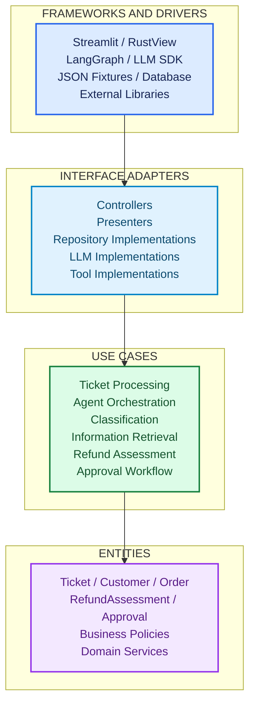
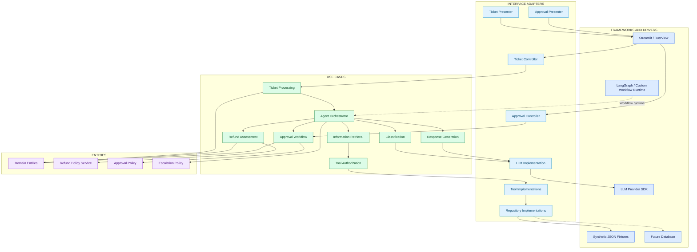
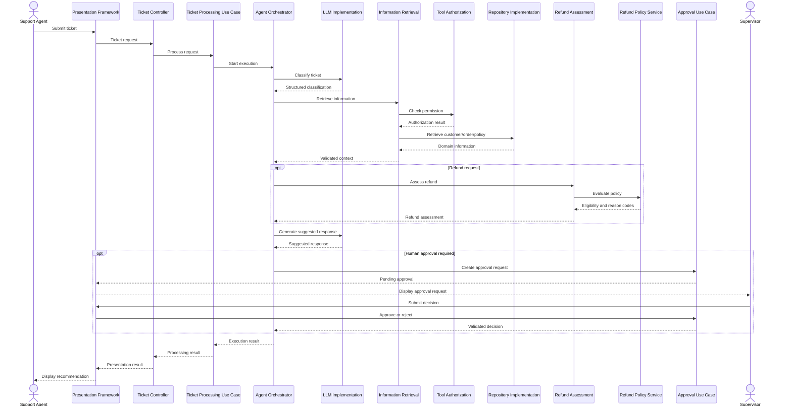

# Component Architecture — AI Customer Support & Ticket Resolution Agent

**Architecture style:** Modular Monolith + Clean Architecture  
**Architecture model:** Four-layer architecture  
**Status:** Updated architecture baseline  
**Applies to:** `ai-agent-py`, `ai-agent-lc`, `ai-agent-rs`

---

## 1. Purpose

This document defines the internal component architecture of the AI Customer Support & Ticket Resolution Agent using Clean Architecture.

It describes:

- The four Clean Architecture layers.
- The responsibilities of internal components.
- The boundaries between business entities, use cases, interface adapters, and frameworks.
- Application interfaces and their implementations.
- Component interactions and dependency direction.
- Technology-specific mappings for the three implementations.

All three implementations must follow the same logical architecture while allowing different programming languages and frameworks.

## 2. Architecture principles

The project follows these principles:

1. **Dependency Rule:** Source-code dependencies point inward.
2. **Business independence:** Enterprise business rules do not depend on frameworks or external technologies.
3. **Use-case independence:** Application workflows do not depend on specific UI frameworks, LLM providers, or persistence technologies.
4. **Interface ownership:** The inner application layer defines the interfaces it requires.
5. **Implementation separation:** Concrete implementations belong to the outer Interface Adapters or Frameworks and Drivers layers.
6. **Deterministic business rules:** Refund eligibility is determined by domain policies, not LLM output.
7. **Explicit authorization:** Tool authorization is enforced by application security logic.
8. **Replaceable infrastructure:** External providers and technical frameworks can be replaced without rewriting business logic.
9. **Human oversight:** Sensitive recommendations follow the approval workflow.
10. **Modular monolith:** Components are logically separated but initially deployed as one application.

## 3. Clean Architecture — Four layers



### 3.1 Onion view

```text
┌──────────────────────────────────────────────────────────┐
│                FRAMEWORKS AND DRIVERS                    │
│                                                          │
│      Streamlit / RustView / LangGraph                    │
│      LLM SDK / JSON Fixtures / Database                  │
│                                                          │
│  ┌────────────────────────────────────────────────────┐  │
│  │               INTERFACE ADAPTERS                   │  │
│  │                                                    │  │
│  │   Controllers / Presenters / Gateways              │  │
│  │   Repository Implementations / LLM Adapters        │  │
│  │                                                    │  │
│  │  ┌──────────────────────────────────────────────┐  │  │
│  │  │                 USE CASES                    │  │  │
│  │  │                                              │  │  │
│  │  │  Ticket Processing                           │  │  │
│  │  │  Agent Orchestration                         │  │  │
│  │  │  Refund Assessment                           │  │  │
│  │  │  Approval Workflow                           │  │  │
│  │  │                                              │  │  │
│  │  │  ┌────────────────────────────────────────┐  │  │  │
│  │  │  │                ENTITIES                │  │  │  │
│  │  │  │                                        │  │  │  │
│  │  │  │  Ticket / Customer / Order             │  │  │  │
│  │  │  │  RefundAssessment / Approval           │  │  │  │
│  │  │  │  Business Policies                     │  │  │  │
│  │  │  └────────────────────────────────────────┘  │  │  │
│  │  └──────────────────────────────────────────────┘  │  │
│  └────────────────────────────────────────────────────┘  │
└──────────────────────────────────────────────────────────┘
```

**Dependency direction: INWARD** — Frameworks and Drivers → Interface Adapters → Use Cases → Entities.

This diagram represents source-code dependency direction. Runtime control flow can cross boundaries through interfaces defined by inner layers.

## 4. Layer 1 — Entities

### Purpose

The Entities layer contains enterprise business rules and domain models.

It represents the core business concepts independently of the application, UI, LLM, and infrastructure.

### Components

| Component | Responsibility |
|---|---|
| Ticket | Ticket identity, content, and lifecycle state |
| Customer | Customer identity and attributes |
| Order | Order identity, status, and details |
| BusinessPolicy | Versioned business policy information |
| RefundAssessment | Refund eligibility and assessment reasons |
| Approval | Approval status and reviewer decision |
| AgentExecution | Agent execution lifecycle |
| AgentDecision | Recorded agent recommendation |
| ToolExecution | Tool execution information |
| AuditEvent | Significant business and security events |

### Domain services

| Service | Responsibility |
|---|---|
| RefundPolicyService | Deterministic refund eligibility |
| TicketClassificationPolicy | Ticket classification business constraints |
| ApprovalPolicyService | Approval business rules |
| TicketEscalationPolicy | Escalation conditions |

### Domain invariants

The Entities layer enforces important business invariants:

- A ticket must have a unique identifier.
- An execution must reference an existing ticket.
- A refund assessment must retain its policy version.
- Refund eligibility must follow deterministic business rules.
- An LLM cannot override refund eligibility.
- An approval requires a valid reviewer.
- A rejected approval cannot authorize a recommendation.
- A failed policy evaluation cannot produce an eligible result.
- Money values must include a currency.

### Dependency restrictions

Entities must not import or depend on:

- LangChain or LangGraph.
- Streamlit or RustView.
- LLM provider SDKs.
- Database clients.
- JSON fixture libraries.
- HTTP clients.
- Presentation frameworks.

The Entities layer must be independently testable.

## 5. Layer 2 — Use Cases

### Purpose

The Use Cases layer contains application-specific business workflows.

It coordinates the Entities layer and defines the application behavior required by users and external systems.

### Components

| Use case | Responsibility |
|---|---|
| TicketProcessingUseCase | Starts and coordinates ticket processing |
| AgentOrchestrator | Coordinates agent execution |
| ClassificationUseCase | Analyzes ticket intent and entities |
| InformationRetrievalUseCase | Retrieves authorized customer, order, and policy information |
| RefundAssessmentUseCase | Coordinates deterministic refund assessment |
| ResponseGenerationUseCase | Generates and validates suggested responses |
| ApprovalUseCase | Processes approval and rejection decisions |
| EscalationUseCase | Coordinates ticket escalation |
| ExecutionHistoryUseCase | Retrieves execution and audit history |

### AgentOrchestrator

The orchestrator coordinates the application workflow.

Responsibilities:

1. Start ticket processing.
2. Request ticket classification.
3. Determine the information required.
4. Coordinate authorized information retrieval.
5. Request refund assessment when applicable.
6. Coordinate suggested response generation.
7. Determine whether human approval is required.
8. Coordinate escalation when necessary.
9. Record execution outcomes.

The orchestrator does not implement refund policy itself.

### Application interfaces

The Use Cases layer defines the interfaces it needs from external capabilities.

Examples:

| Interface | Required operation | Purpose |
|---|---|---|
| CustomerRepository | `get_customer` | Retrieve customer information |
| OrderRepository | `get_order` | Retrieve order information |
| PolicyRepository | `get_policy` | Retrieve business policy |
| TicketRepository | `save_ticket`, `get_ticket` | Manage ticket data |
| ExecutionRepository | `save_execution`, `get_execution` | Manage execution history |
| ApprovalRepository | `save_approval`, `get_approval` | Manage approval records |
| LLMClient | `generate_structured_output` | Request structured model output |
| ResponseGenerator | `generate_response` | Generate suggested responses |
| Clock | `now` | Provide a testable time source |
| AuditWriter | `record_event` | Record audit events |

These interfaces belong to the application boundary.

The Use Cases layer defines what it needs without depending on how the capability is implemented.

### Example interface

```python
from typing import Protocol

class OrderRepository(Protocol):
    def get_order(self, order_id: str) -> "Order | None":
        ...
```

The application defines the interface. An outer layer provides its concrete implementation.

## 6. Layer 3 — Interface Adapters

### Purpose

The Interface Adapters layer translates data and operations between the Use Cases layer and external technologies.

It contains controllers, presenters, and concrete implementations of application interfaces.

### Components

| Component | Responsibility |
|---|---|
| TicketController | Converts UI requests into ticket-processing requests |
| ApprovalController | Converts UI approval actions into application requests |
| TicketPresenter | Converts execution results into presentation data |
| ApprovalPresenter | Converts approval results into presentation data |
| CustomerRepositoryImplementation | Implements customer retrieval |
| OrderRepositoryImplementation | Implements order retrieval |
| PolicyRepositoryImplementation | Implements policy retrieval |
| LLMImplementation | Implements the application LLM interface |
| ToolImplementations | Execute authorized application tools |
| APIController | Exposes application use cases through an optional API |

### Controller responsibilities

Controllers:

- Receive user actions.
- Validate basic request structure.
- Convert requests into application input models.
- Invoke the appropriate use case.
- Return the result through a presenter.

Controllers must not contain refund business rules.

### Presenter responsibilities

Presenters:

- Convert application results into UI-friendly data.
- Format ticket status.
- Present classification and confidence information.
- Display refund assessment reasons.
- Display approval status.
- Present errors safely.

Presenters must not make business decisions.

### Repository implementation responsibilities

Concrete repository implementations:

- Read synthetic JSON fixtures.
- Translate external data into domain objects.
- Handle persistence-specific errors.
- Implement the application-defined repository interfaces.

A future database implementation can replace the JSON implementation without changing the domain entities or use cases.

## 7. Layer 4 — Frameworks and Drivers

### Purpose

The Frameworks and Drivers layer contains external technical mechanisms and frameworks.

These technologies are replaceable details rather than the source of business rules.

### Initial technologies

| Technology | Responsibility |
|---|---|
| Streamlit | Python and LangChain presentation |
| RustView | Rust presentation |
| LangGraph | LangChain workflow execution |
| LLM provider SDK | External model communication |
| JSON fixtures | Synthetic customer, order, and policy data |
| Python runtime | Python application execution |
| Rust runtime | Rust application execution |

### Potential future technologies

| Technology | Possible responsibility |
|---|---|
| FastAPI | HTTP application interface |
| PostgreSQL | Persistent data storage |
| External identity provider | Authentication |
| OpenTelemetry | Distributed tracing |
| External CRM | Customer data integration |
| External OMS | Order data integration |

Future technologies are not mandatory for the initial implementation.

## 8. Application interfaces and concrete implementations

The relationship between the inner application and outer implementations must remain explicit.

| Application interface | Concrete implementation |
|---|---|
| CustomerRepository | JSON customer repository |
| OrderRepository | JSON order repository |
| PolicyRepository | JSON policy repository |
| TicketRepository | In-memory or JSON ticket repository |
| ExecutionRepository | In-memory or JSON execution repository |
| ApprovalRepository | In-memory or JSON approval repository |
| LLMClient | Provider-specific LLM client |
| ResponseGenerator | LLM-backed response generator |
| AuditWriter | Structured logging implementation |
| Clock | System clock implementation |

These implementations belong outside the Entities and Use Cases layers.

## 9. Cross-cutting components

Security, guardrails, and observability are cross-cutting concerns. They support multiple components and must not be confined to a single framework or LLM integration.

### 9.1 Guardrails

Responsibilities:

- Input validation.
- Output validation.
- Prompt-injection handling.
- Structured-output validation.
- Tool allowlist enforcement.
- Policy compliance checks.
- Safe failure behavior.

### 9.2 Security

Responsibilities:

- Authentication boundary.
- Role-based authorization.
- Tool-level permissions.
- Secret management.
- Data minimization.
- Auditability.
- Secure error handling.

### 9.3 Observability

Responsibilities:

- Structured logging.
- Execution correlation IDs.
- Tool invocation records.
- Guardrail outcomes.
- Approval events.
- Error and timeout information.
- Model and prompt version tracking.
- Duration and token usage where available.

## 10. Component architecture diagram



This diagram represents logical responsibilities. It does not imply separate microservices or separate deployment units.

## 11. Main runtime interaction



The sequence describes logical runtime collaboration. Framework-specific execution details are documented separately.

## 12. Dependency Rule

The following rules are mandatory.

| ID | Rule |
|---|---|
| DEP-001 | Entities must not depend on Use Cases |
| DEP-002 | Entities must not depend on Interface Adapters |
| DEP-003 | Entities must not depend on Frameworks and Drivers |
| DEP-004 | Use Cases may depend on Entities |
| DEP-005 | Use Cases define the application interfaces they require |
| DEP-006 | Interface Adapters implement or translate those interfaces |
| DEP-007 | Frameworks and Drivers provide concrete technical mechanisms |
| DEP-008 | Domain policies must not depend on LLM output |
| DEP-009 | Authorization must not depend on LLM decisions |
| DEP-010 | UI components must not contain business-policy logic |
| DEP-011 | Framework-specific workflow state must not replace shared domain entities |
| DEP-012 | Infrastructure implementations must be replaceable |

## 13. Technology mapping

| Architecture responsibility | `ai-agent-py` | `ai-agent-lc` | `ai-agent-rs` |
|---|---|---|---|
| Presentation | Streamlit | Streamlit | RustView |
| Workflow implementation | Custom Python orchestrator | LangGraph | Rust workflow |
| Domain model | Python | Python | Rust |
| LLM integration | Provider implementation | LangChain model implementation | Provider implementation |
| Repository implementation | JSON adapters | JSON adapters | JSON adapters |
| Tool implementation | Python | LangChain tools | Rust |
| Guardrails | Python services | Python services | Rust services |
| Security | Python services | Python services | Rust services |
| Evaluation | Shared evaluation contract | Shared evaluation contract | Shared evaluation contract |
| Observability | Structured logging | Structured logging | Structured logging |

Frameworks can differ, but business behavior and application contracts must remain consistent.

## 14. Suggested package mapping

### 14.1 `ai-agent-py`

```text
src/support_agent/
├── entities/
│   ├── models/
│   ├── value_objects/
│   ├── policies/
│   └── events/
├── use_cases/
│   ├── interfaces/
│   ├── ticket_processing/
│   ├── classification/
│   ├── information_retrieval/
│   ├── refund_assessment/
│   └── approval/
├── interface_adapters/
│   ├── controllers/
│   ├── presenters/
│   ├── repositories/
│   ├── llm/
│   └── tools/
├── frameworks/
│   ├── ui/
│   ├── llm/
│   ├── persistence/
│   └── configuration/
├── guardrails/
├── security/
├── evaluation/
└── observability/
```

### 14.2 `ai-agent-lc`

```text
src/support_agent/
├── entities/
│   ├── models/
│   ├── value_objects/
│   ├── policies/
│   └── events/
├── use_cases/
│   ├── interfaces/
│   ├── ticket_processing/
│   ├── classification/
│   ├── information_retrieval/
│   ├── refund_assessment/
│   └── approval/
├── interface_adapters/
│   ├── controllers/
│   ├── presenters/
│   ├── repositories/
│   └── tools/
├── frameworks/
│   ├── graphs/
│   │   ├── state.py
│   │   ├── nodes.py
│   │   ├── edges.py
│   │   └── workflow.py
│   ├── llm/
│   ├── ui/
│   └── persistence/
├── guardrails/
├── security/
├── evaluation/
└── observability/
```

LangGraph belongs to the framework/workflow implementation boundary. Its state and node definitions must not replace the shared domain entities or application use cases.

### 14.3 `ai-agent-rs`

```text
src/
├── entities/
│   ├── models/
│   ├── value_objects/
│   ├── policies/
│   └── events/
├── use_cases/
│   ├── interfaces/
│   ├── ticket_processing/
│   ├── classification/
│   ├── information_retrieval/
│   ├── refund_assessment/
│   └── approval/
├── interface_adapters/
│   ├── controllers/
│   ├── presenters/
│   ├── repositories/
│   ├── llm/
│   └── tools/
├── frameworks/
│   ├── ui/
│   ├── llm/
│   ├── persistence/
│   └── configuration/
├── guardrails/
├── security/
├── evaluation/
└── observability/
```

Rust module visibility and trait boundaries should enforce the intended dependency direction where practical.

## 15. Architecture constraints

- All implementations preserve the shared domain invariants.
- Business policies are deterministic and independently testable.
- Use cases do not import provider-specific SDKs.
- The LLM cannot authorize tool access.
- The LLM cannot override refund eligibility.
- Controllers invoke application use cases.
- Presenters format results without making business decisions.
- Repository implementations remain outside the Entities layer.
- Framework-specific workflow state is translated into application/domain types.
- Infrastructure can be replaced without rewriting business logic.
- All three implementations follow the same functional requirements.

## 16. Traceability

| Architecture element | Related specification |
|---|---|
| System boundary | `architecture/system-context.md` |
| Domain entities | `specifications/04-domain-model.md` |
| Agent contracts | `specifications/05-agent-contracts.md` |
| Architecture principles | `specifications/06-architecture.md` |
| Functional requirements | `specifications/02-requirements.md` |
| Security requirements | `engineering/security/` |
| Guardrail requirements | `engineering/guardrails/` |
| Evaluation requirements | `engineering/evaluation/` |

## 17. Definition of Done

- [ ] Four Clean Architecture layers are documented.
- [ ] Entity responsibilities are explicit.
- [ ] Use-case responsibilities are explicit.
- [ ] Interface Adapter responsibilities are explicit.
- [ ] Frameworks and Drivers responsibilities are explicit.
- [ ] Application interfaces are owned by the Use Cases layer.
- [ ] Concrete implementations are outside the inner layers.
- [ ] Dependency Rule is documented.
- [ ] LLM integration is isolated.
- [ ] Tool authorization is independently enforced.
- [ ] Refund policy remains deterministic.
- [ ] Approval workflow is documented.
- [ ] Cross-cutting concerns are identified.
- [ ] Component architecture diagram is included.
- [ ] Runtime sequence diagram is included.
- [ ] All three implementation mappings are documented.
- [ ] Document is consistent with the shared specifications.
- [ ] Document is committed to `ai-agent-shared`.

---

**Next step:** Step 12 — Define Sequence Diagrams for the main business workflows.
