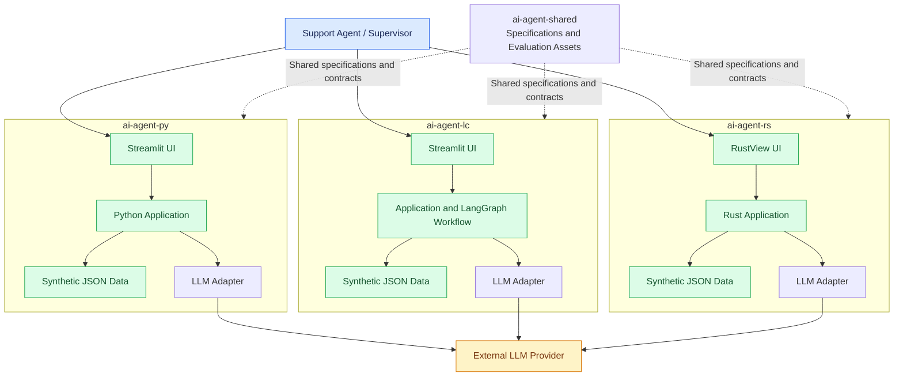
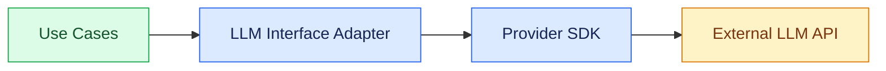
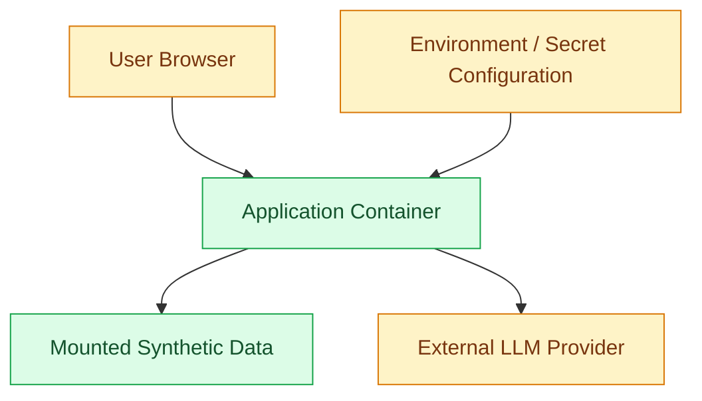

# Deployment Architecture

## 1. Purpose

This document defines the deployment architecture for the AI Customer Support and Ticket Resolution Agent portfolio.

It establishes a consistent deployment model across:

- `ai-agent-py` — Plain Python and Streamlit.
- `ai-agent-lc` — LangChain, LangGraph and Streamlit.
- `ai-agent-rs` — Rust and RustView.
- `ai-agent-shared` — Shared specifications, contracts, evaluation datasets and engineering standards.

The deployment design must preserve the project's Modular Monolith and Clean Architecture principles.

## 2. Deployment Objectives

The deployment architecture must:

1. Support local development with minimal infrastructure.
2. Keep the three implementations independently executable.
3. Use synthetic customer, order and policy data.
4. Keep secrets outside source control.
5. Support external LLM provider integration through an adapter.
6. Provide consistent logging and error handling.
7. Support automated tests and evaluation.
8. Allow future containerization and cloud deployment.
9. Avoid introducing unnecessary infrastructure during initial development.

## 3. Deployment Scope

### Initial deployment

The initial target is local development and demonstration.

Each implementation runs as one application process:

| Repository | Application | Execution model |
|---|---|---|
| `ai-agent-py` | Streamlit application | Python process |
| `ai-agent-lc` | Streamlit application | Python process |
| `ai-agent-rs` | RustView application | Rust application process |

The shared repository is not a runtime service. It provides specifications and shared development assets.

### Out of scope

The initial deployment does not include:

- Kubernetes.
- Distributed microservices.
- Production CRM or OMS integration.
- Real payment gateways.
- Production customer databases.
- Multi-region deployment.
- Autonomous financial transactions.
- Production-grade multi-tenant infrastructure.

These can be considered in a later architecture evolution.

## 4. Logical Deployment Architecture



Each implementation is independently deployable. The diagram shows the alternatives, not three applications that must run together.

## 5. Deployment Model by Repository

### 5.1 `ai-agent-py`

**Technology:** Python, Streamlit, custom agent orchestrator.

Runtime components:

- Streamlit interface.
- Application use cases.
- Domain entities and policies.
- Interface adapters.
- LLM provider adapter.
- Synthetic JSON repositories.
- Guardrails, security, evaluation and observability modules.

Deployment:

- One Python process.
- One local application instance.
- Local JSON fixtures.
- External LLM access when configured.

Example:

```bash
uv sync
uv run streamlit run app/streamlit_app.py
```

### 5.2 `ai-agent-lc`

**Technology:** Python, Streamlit, LangChain and LangGraph.

Runtime components:

- Streamlit interface.
- Application use cases.
- Domain entities and policies.
- LangGraph workflow implementation.
- LLM and tool adapters.
- Synthetic JSON repositories.
- Guardrails, security, evaluation and observability modules.

Deployment:

- One Python process.
- LangGraph executes inside the application.
- Streamlit provides the user interface.
- Synthetic data is loaded through repository adapters.

Example:

```bash
uv sync
uv run streamlit run app/streamlit_app.py
```

LangGraph is a workflow implementation detail. It does not replace the shared domain model or application use cases.

### 5.3 `ai-agent-rs`

**Technology:** Rust and RustView.

Runtime components:

- RustView user interface.
- Rust application workflows.
- Domain entities and policies.
- Interface adapters.
- LLM provider adapter.
- Synthetic JSON repositories.
- Guardrails, security, evaluation and observability modules.

Deployment:

- One Rust application process, subject to the selected RustView execution model.
- Local synthetic data.
- External LLM access when configured.

Example:

```bash
cargo build
cargo run
```

The exact RustView build and run commands must be validated during the Rust implementation setup.

## 6. Environment Configuration

Each implementation must provide an `.env.example` file.

Example:

```dotenv
APP_ENV=development
APP_LOG_LEVEL=INFO

LLM_PROVIDER=
LLM_MODEL=
LLM_API_KEY=

LLM_TIMEOUT_SECONDS=30
LLM_MAX_RETRIES=2

DATA_DIRECTORY=./data

ENABLE_SYNTHETIC_DATA=true
ENABLE_EXTERNAL_LLM=false

AUDIT_LOG_PATH=./logs/audit.jsonl
```

### Configuration rules

- `.env.example` contains variable names and safe example values only.
- `.env` must not be committed.
- API keys must never appear in source code or logs.
- Missing optional LLM configuration must not prevent deterministic domain tests from running.
- The application must validate required configuration during startup.
- Production credentials must be managed through a dedicated secrets mechanism.
- Configuration must be accessed through an application configuration component rather than scattered environment lookups.

The values above are initial development defaults. Final configuration requirements are implementation-specific.

## 7. Synthetic Data Deployment

Initial data is stored as JSON fixtures within each implementation repository.

Example:

```text
data/
├── customers.json
├── orders.json
├── policies.json
└── tickets.json
```

Responsibilities:

| Data | Purpose |
|---|---|
| customers.json | Synthetic customer profiles |
| orders.json | Synthetic order information |
| policies.json | Business policy configuration |
| tickets.json | Sample support tickets |

### Data access rules

1. Use repository adapters to access JSON files.
2. Keep JSON parsing outside the Entities layer.
3. Validate data when loading it.
4. Avoid modifying source fixtures during normal execution.
5. Do not store real customer information.
6. Keep fixtures consistent with shared contracts and evaluation datasets.

A future database can replace JSON storage without changing the domain entities or core application workflows.

## 8. External LLM Deployment Boundary

The LLM provider is an external dependency.



### LLM deployment rules

- Provider-specific SDK usage remains in the outer layers.
- The application uses a stable application-owned interface.
- Model and provider configuration are externalized.
- Request timeouts and bounded retries are required.
- LLM responses are validated before use.
- Sensitive data must be minimized before external transmission.
- LLM unavailability must not bypass deterministic business rules.
- The application must not expose provider credentials to the UI.

The exact LLM provider and model remain open decisions.

## 9. Networking and Access

### Initial local development

- The UI is accessed through its local application address.
- The application communicates with local JSON fixtures.
- External LLM requests use HTTPS when enabled.
- No publicly accessible backend API is required initially.
- No production authentication service is required initially, but application role and authorization logic must be testable.

### Future deployment

A future deployment may introduce:

- A separately hosted application API.
- Reverse proxy and TLS termination.
- Centralized identity management.
- Managed database.
- Centralized secrets management.
- Centralized logs and traces.
- Container-based deployment.

These are future architecture options, not current implementation requirements.

## 10. Deployment Environments

| Environment | Purpose | Data | LLM |
|---|---|---|---|
| Local development | Feature development | Synthetic JSON | Optional |
| Test | Automated testing | Synthetic fixtures | Mocked or controlled test provider |
| Evaluation | Measure agent quality | Shared evaluation datasets | Controlled provider/model |
| Demo | Portfolio demonstration | Synthetic data | Configured provider or deterministic fallback |

### Environment isolation

- Tests must not depend on a developer's personal LLM credentials.
- Evaluation runs must record model and prompt versions when an LLM is used.
- Demo data must remain synthetic.
- Test and evaluation outputs must be distinguishable from normal application logs.

## 11. Observability Deployment

Initial observability is local and application-managed.

Expected outputs:

```text
logs/
├── application.log
├── audit.jsonl
└── evaluation/
```

The application should record:

- Execution ID.
- Ticket ID.
- Workflow status.
- Model and prompt version when applicable.
- Tool invocation name and outcome.
- Guardrail decisions.
- Approval events.
- Duration.
- Errors and failure categories.
- Token usage when available.

Never log API keys, credentials, or unnecessary sensitive customer content.

Future options include structured centralized logging and OpenTelemetry.

## 12. Containerization Strategy

Containerization is not required for the first implementation milestone.

When introduced, each implementation should be independently containerizable.

Potential deployment model:



Containerization must preserve:

- Configuration externalization.
- Non-root execution where supported.
- Minimal runtime dependencies.
- Health and readiness checks where applicable.
- No secrets embedded in image layers.
- Read-only access to fixture files where practical.

## 13. Deployment Security

- Never commit `.env` or credentials.
- Use HTTPS for external service calls.
- Restrict application access to permitted users and roles.
- Validate all user input.
- Validate LLM output.
- Enforce tool authorization in application code.
- Keep synthetic data separate from any future real data.
- Avoid exposing internal errors through the interface.
- Record security-relevant events.
- Review dependency vulnerabilities.

## 14. Architecture Evolution

| Current design | Possible future evolution |
|---|---|
| Local Streamlit application | Hosted web application |
| Local RustView application | Packaged or hosted RustView application |
| JSON repositories | Relational database |
| Local logs | Centralized observability |
| Environment variables | Managed secrets |
| Local execution | Container deployment |
| Direct LLM provider access | Managed model gateway |
| Application-level demo roles | Enterprise identity provider |

Future changes must preserve Clean Architecture boundaries and shared business contracts.

## 15. Open Deployment Decisions

The following decisions remain open:

1. Which LLM provider and model will be used?
2. Will the portfolio require a hosted demo?
3. Will Docker be introduced during implementation or after functional completion?
4. Which deployment platform will host the portfolio applications?
5. Will a future API be required independently of the UI?
6. Which centralized observability stack should be evaluated?

Do not introduce infrastructure until a documented requirement justifies it.

## 16. Traceability

| Deployment concern | Related architecture or specification |
|---|---|
| Application packaging | `specifications/06-architecture.md` |
| Runtime interaction | `architecture/sequence-diagrams.md` |
| Synthetic data | `specifications/04-domain-model.md` |
| Configuration and provider integration | `specifications/05-agent-contracts.md` |
| Security | `engineering/security/` |
| Observability | `engineering/observability/` |
| Testing | `engineering/testing/test-strategy.md` |
| Portfolio completion | `specifications/07-definition-of-done.md` |

## 17. Definition of Done

- [ ] Deployment architecture documented.
- [ ] Three implementation deployment models described.
- [ ] Logical deployment diagram included.
- [ ] LLM provider boundary documented.
- [ ] Environment configuration strategy documented.
- [ ] Synthetic data deployment strategy documented.
- [ ] Local development model documented.
- [ ] Test and evaluation environments defined.
- [ ] Observability deployment strategy documented.
- [ ] Containerization treated as a future option, not a premature requirement.
- [ ] Security requirements documented.
- [ ] Open deployment decisions recorded.
- [ ] Mermaid diagrams render correctly.
- [ ] Deployment design remains consistent with Clean Architecture.
