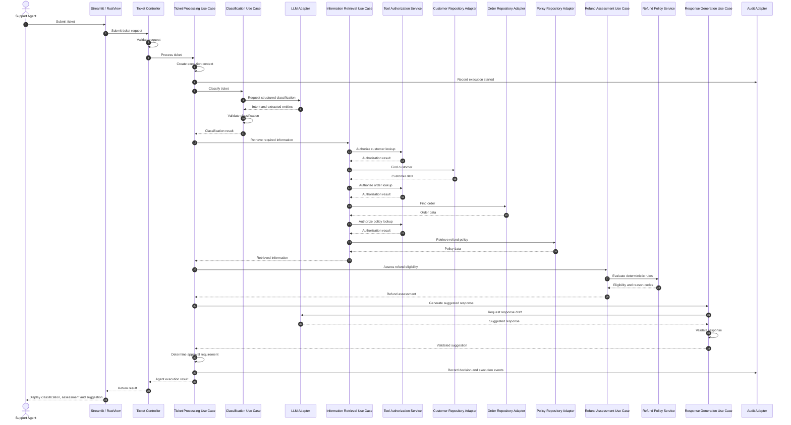
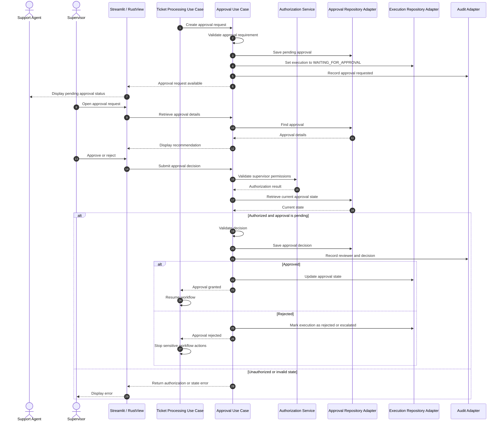
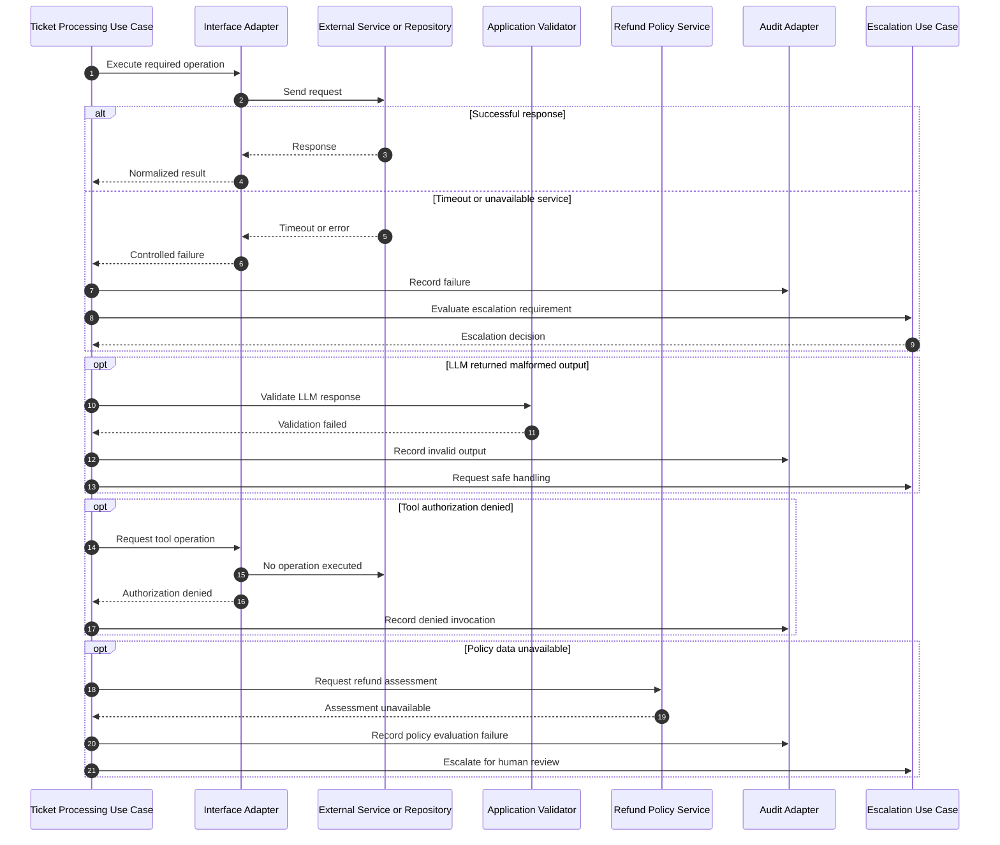
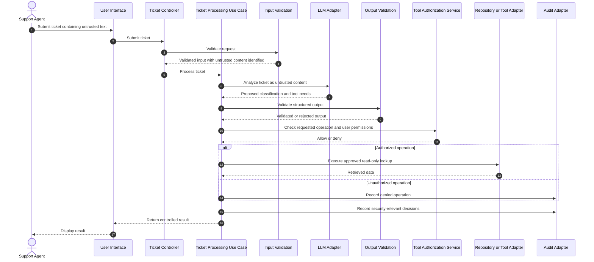
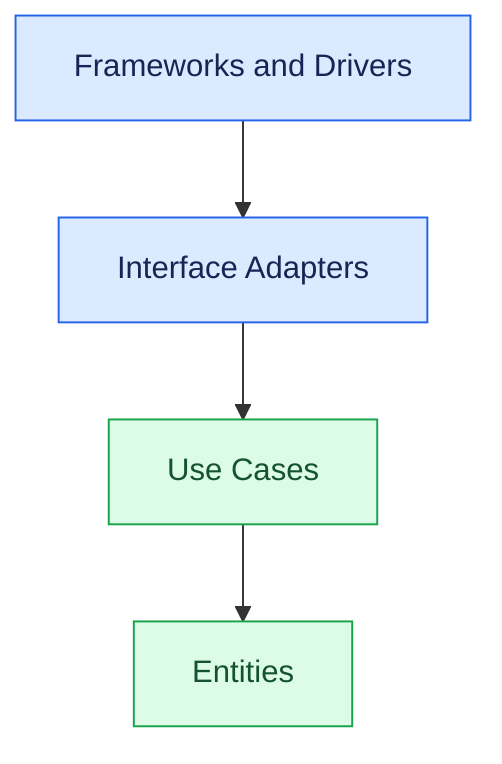

# Sequence Diagrams

## 1. Purpose

This document describes the runtime interactions between actors, application workflows, domain services, interface adapters, frameworks and drivers, and external systems.

The diagrams complement:

- `specifications/06-architecture.md`
- `architecture/system-context.md`
- `architecture/component-diagram.md`
- `specifications/03-use-cases.md`
- `specifications/04-domain-model.md`
- `specifications/05-agent-contracts.md`

The architecture follows **Modular Monolith + Clean Architecture**.

The four architectural layers are:

1. Entities
2. Use Cases
3. Interface Adapters
4. Frameworks and Drivers

## 2. Scope

The diagrams cover:

- Ticket submission and processing.
- Intent classification and information retrieval.
- Deterministic refund eligibility assessment.
- Suggested response generation.
- Human approval.
- Error handling.
- Security and untrusted input handling.

The system uses synthetic data and does not execute real financial transactions.

## 3. Participants and Responsibilities

| Participant | Responsibility |
|---|---|
| Support Agent | Submits and reviews tickets |
| Supervisor | Reviews sensitive recommendations |
| Streamlit / RustView | Presents the application interface |
| Ticket Controller | Receives and validates application requests |
| Ticket Processing Use Case | Coordinates ticket processing |
| Classification Use Case | Identifies ticket intent |
| Information Retrieval Use Case | Coordinates customer, order and policy retrieval |
| Refund Assessment Use Case | Coordinates refund eligibility assessment |
| Refund Policy Service | Applies deterministic refund rules |
| Response Generation Use Case | Produces a suggested response |
| Approval Use Case | Coordinates approval and rejection |
| Domain Entities | Enforce business invariants |
| LLM Adapter | Communicates with the selected LLM provider |
| Repository Adapters | Retrieve synthetic customer, order and policy data |
| Tool Authorization Service | Enforces application-level tool permissions |
| Audit Adapter | Records significant execution events |

## 4. Main Ticket Processing Workflow

### 4.1 Scenario

A support agent submits a ticket:

`My order #4821 has not arrived. Can I get a refund?`

The application:

1. Validates the ticket.
2. Creates an agent execution.
3. Classifies the ticket.
4. Retrieves customer and order information.
5. Retrieves applicable business policy.
6. Assesses refund eligibility deterministically.
7. Generates a suggested response.
8. Determines whether human approval is required.
9. Returns the execution result.

### 4.2 Sequence Diagram

### 4.3 Important Architectural Rules

- The LLM may classify tickets and draft customer responses.
- The LLM does not make authoritative refund eligibility decisions.
- The Refund Policy Service applies deterministic business rules.
- Tool authorization is enforced by application code, not by the LLM.
- Repository adapters provide data to the application workflows.
- The application records significant decisions and execution events.
- A suggested response is not automatically sent to the customer.

## 5. Human Approval Workflow

### 5.1 Scenario

A refund recommendation requires supervisor approval.

The application must:

1. Create an approval request.
2. Set the execution status to `WAITING_FOR_APPROVAL`.
3. Present the recommendation to a supervisor.
4. Validate the supervisor's identity and authorization.
5. Validate the approval request state.
6. Record the decision.
7. Resume or terminate the application workflow.

Approval is an internal workflow decision. It does not trigger a real refund transaction.

### 5.2 Approval Sequence Diagram

### 5.3 Approval Invariants

- Only an authorized supervisor can approve or reject a request.
- An approval request must exist.
- Only a pending approval can receive a new decision.
- The reviewer identity must be recorded.
- A rejected approval cannot authorize a sensitive action.
- An approval decision cannot modify the deterministic refund assessment.
- Approval does not mean that a financial transaction has occurred.

## 6. Error Handling and Safe Failure

### 6.1 Error Scenarios

| Scenario | Expected behavior |
|---|---|
| LLM timeout | Apply bounded retry policy, then fail safely or escalate |
| Invalid LLM output | Reject the output and record validation failure |
| Unauthorized tool invocation | Deny the operation and record the security event |
| Customer or order lookup failure | Return a controlled retrieval error |
| Policy data unavailable | Do not declare the refund eligible |
| Approval repository failure | Do not assume approval succeeded |
| Invalid approval state | Reject the decision request |
| Audit failure | Apply the documented audit-failure policy; do not silently discard required audit events |

### 6.2 Error Handling Sequence Diagram

### 6.3 Safe Failure Rules

1. Never convert a failed policy evaluation into an eligible refund decision.
2. Never treat a timeout as a successful tool result.
3. Never accept malformed structured LLM output.
4. Never retry an operation indefinitely.
5. Never bypass tool authorization after a failure.
6. Preserve execution and correlation identifiers in error records.
7. Escalate when the application cannot safely determine the next action.
8. Do not expose stack traces, secrets, or internal implementation details to the user interface.

## 7. Security and Untrusted Ticket Content

### 7.1 Scenario

A ticket contains instructions attempting to manipulate the agent, such as asking it to ignore business rules or disclose internal information.

Ticket content is untrusted data. It must not be treated as an application instruction.

### 7.2 Sequence Diagram

### 7.3 Security Rules

- Ticket content is untrusted input.
- LLM output is untrusted until validated.
- LLM-generated instructions cannot grant permissions.
- Tool access is restricted through an application-controlled allowlist.
- Read-only operations are the initial tool scope.
- Customer and order data must be limited to the authorized request context.
- Secrets and credentials must never be included in prompts.
- Security-relevant events must be recorded without unnecessarily logging sensitive content.

## 8. Runtime Calls Versus Source-Code Dependencies

Sequence diagrams describe **runtime interaction order**. They do not redefine source-code dependency direction.

The project follows the Clean Architecture Dependency Rule:

| Layer | Responsibility |
|---|---|
| Entities | Core domain rules and invariants |
| Use Cases | Application workflows and application-owned interfaces |
| Interface Adapters | Controllers, presenters, repository and service implementations |
| Frameworks and Drivers | UI frameworks, LLM SDKs, storage mechanisms and workflow frameworks |

Source-code dependencies point inward:

The Use Cases layer defines the application interfaces it requires. Outer-layer adapters implement or translate those interfaces.

For example:

- A Use Case requests an order lookup through an application-owned interface.
- An Order Repository Adapter implements that interface.
- The adapter uses the selected storage mechanism.
- The Use Case does not depend on the storage implementation.

A runtime call can therefore reach an outer-layer implementation without changing the inward source-code dependency rule.

## 9. Mapping to the Three Implementations

| Concern | `ai-agent-py` | `ai-agent-lc` | `ai-agent-rs` |
|---|---|---|---|
| Entities | Python domain models | Shared domain models | Rust domain types |
| Use Cases | Python application services | Application services | Rust application services |
| Interface Adapters | Controllers and repository adapters | Controllers and repository adapters | Controllers and repository adapters |
| Frameworks and Drivers | Streamlit, LLM SDK, JSON fixtures | Streamlit, LangGraph, LLM SDK | RustView, LLM client, JSON fixtures |
| Workflow coordination | Custom Python orchestrator | LangGraph workflow | Rust application workflow |
| Deterministic refund rules | Refund Policy Service | Refund Policy Service | Refund Policy Service |
| Human approval | Approval Use Case | Approval Use Case and workflow interruption | Approval Use Case |

All implementations must preserve the same business behavior and shared contracts.

## 10. Traceability

| Sequence | Use cases | Requirements | Domain concepts |
|---|---|---|---|
| Main ticket processing | UC-01 to UC-06 | Ticket processing, classification, retrieval, assessment and response requirements | Ticket, AgentExecution, AgentDecision, RefundAssessment |
| Human approval | UC-07 | Approval and authorization requirements | Approval, AgentExecution, AuditEvent |
| Error handling | UC-08, UC-09 | Reliability, safe failure and audit requirements | ExecutionStatus, ToolExecution, AuditEvent |
| Security handling | UC-01 to UC-09 | Input validation, tool authorization and data protection requirements | ToolExecution, AgentExecution, AuditEvent |

## 11. Design Constraints

The following constraints apply to every implementation:

1. No real financial transactions.
2. No unrestricted autonomous actions.
3. Refund eligibility remains deterministic.
4. The LLM cannot override business rules.
5. Sensitive actions require the defined human approval workflow.
6. Tool authorization is independent of LLM output.
7. Failures must not silently produce successful business decisions.
8. Significant decisions must be auditable.
9. All three implementations must conform to shared contracts.
10. Clean Architecture dependency direction must be maintained.

## 12. Definition of Done

- [ ] Main ticket-processing sequence diagram is documented.
- [ ] Human approval sequence diagram is documented.
- [ ] Error handling sequence diagram is documented.
- [ ] Security sequence diagram is documented.
- [ ] Runtime interactions are consistent with the component diagram.
- [ ] Clean Architecture layers are used consistently.
- [ ] Source-code dependency direction is explained.
- [ ] No Hexagonal Architecture or Ports and Adapters classification is introduced.
- [ ] No real refund execution is represented.
- [ ] Requirements and use-case traceability is included.
- [ ] The diagrams are valid Mermaid syntax.
