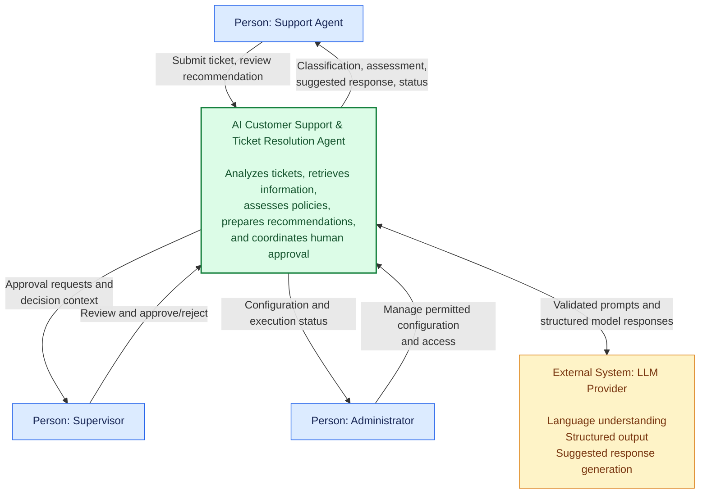

# System Context — AI Customer Support & Ticket Resolution Agent

**Architecture level:** C4 Model — Level 1 (System Context)  
**Status:** Initial architecture baseline  
**Architecture style:** Modular Monolith + Clean Architecture  
**Applies to:** `ai-agent-py`, `ai-agent-lc`, `ai-agent-rs`

---

## 1. Purpose

This document defines the system boundary, external actors, external dependencies, and information exchanges for the AI Customer Support & Ticket Resolution Agent.

It establishes a shared context for all three implementations:

- `ai-agent-py`
- `ai-agent-lc`
- `ai-agent-rs`

The purpose is to ensure all implementations solve the same business problem, interact with the same categories of actors, and respect the same system boundaries.

## 2. System overview

The AI Customer Support & Ticket Resolution Agent helps support teams process customer tickets.

The system:

1. Receives a customer support ticket.
2. Identifies the customer's intent and relevant entities.
3. Retrieves customer, order, and policy information.
4. Assesses refund eligibility using deterministic business rules.
5. Generates a suggested customer response.
6. Requests human approval when required.
7. Records decisions, tool executions, and audit events.
8. Returns the processing result to the support team.

The LLM assists with language understanding and response generation. It does not have authority to override business rules, authorization checks, or approval requirements.

## 3. Primary actors

| Actor | Type | Responsibilities |
|---|---|---|
| Support Agent | Primary human actor | Submits tickets, reviews recommendations, handles customer cases |
| Supervisor | Primary human actor | Reviews sensitive recommendations and approval requests |
| Administrator | Human administrative actor | Manages application configuration and access |
| AI Agent | Internal system capability | Analyzes tickets and coordinates processing |
| LLM Provider | External software dependency | Provides language understanding and response generation |

## 4. System boundary

### 4.1 Inside the system

The application owns:

- Ticket intake and validation.
- Agent execution orchestration.
- Intent detection and entity extraction.
- Customer lookup.
- Order lookup.
- Policy lookup.
- Deterministic refund assessment.
- Tool authorization.
- Input and output guardrails.
- Suggested response generation.
- Human approval workflow.
- Ticket status management.
- Execution history.
- Audit event generation.
- Application-level role and permission enforcement.

### 4.2 Outside the system

The initial system interacts with:

- Support Agents.
- Supervisors.
- Administrators.
- An external LLM provider.

Future integration candidates include:

- External CRM.
- External Order Management System (OMS).
- External identity provider.
- External database or persistent storage.
- External observability platform.

These future integrations are not required for the initial implementation.

### 4.3 Initial data boundary

The initial implementation uses synthetic JSON fixtures for customers, orders, and business policies.

These fixtures are accessed through infrastructure adapters within the application boundary.

This means the initial architecture does not require a real CRM, OMS, or external policy service.

The application should nevertheless define abstractions that allow those integrations to be introduced later without changing the domain model.

## 5. C4 Level 1 — System Context Diagram

## 6. Actor interaction descriptions

### 6.1 Support Agent

The Support Agent is the primary user of the application.

Responsibilities:

- Submit a ticket for analysis.
- View ticket classification.
- Review extracted customer and order references.
- View customer and order information.
- Review refund assessments.
- Review suggested customer responses.
- Track ticket processing status.
- Escalate cases when necessary.

The Support Agent cannot bypass authorization or business-policy restrictions.

### 6.2 Supervisor

The Supervisor provides human oversight.

Responsibilities:

- Review pending approval requests.
- Inspect the relevant ticket and supporting information.
- Review the deterministic refund assessment.
- Approve or reject recommendations.
- Provide a decision reason.
- Review execution history.

An approval authorizes the corresponding workflow decision; it does not execute a real financial transaction in the initial scope.

### 6.3 Administrator

The Administrator manages permitted administrative functions.

Responsibilities:

- Manage application-level configuration.
- Manage user roles and permissions where supported.
- Inspect system execution information.
- Review operational and audit information.

Administrative access must follow the authorization rules defined in the shared security specifications.

### 6.4 LLM Provider

The LLM Provider is an external dependency.

Responsibilities:

- Interpret natural-language ticket content.
- Extract structured information.
- Support classification and intent analysis.
- Generate suggested customer responses.

Restrictions:

- Cannot authorize tools.
- Cannot independently approve refund requests.
- Cannot override deterministic refund eligibility.
- Cannot modify customer or order records.
- Cannot execute financial transactions.
- Cannot grant itself additional permissions.

The application validates all model output before using it.

## 7. External interaction contracts

| Interaction | Direction | Data exchanged | Security requirement |
|---|---|---|---|
| Ticket submission | Agent → System | Ticket content and references | Input validation |
| Ticket analysis result | System → Agent | Intent, entities, status | Role-based access |
| Approval request | System → Supervisor | Ticket and recommendation context | Supervisor authorization |
| Approval decision | Supervisor → System | Decision, reviewer, reason | Identity and authorization validation |
| Model request | System → LLM | Minimum required prompt context | Data minimization |
| Model response | LLM → System | Structured result or generated text | Output validation |
| Administrative operation | Administrator ↔ System | Permitted configuration and status | Administrative authorization |

## 8. Key information flows

### 8.1 Ticket processing

1. Support Agent submits a ticket.
2. System validates the input.
3. Agent workflow analyzes the ticket.
4. System retrieves relevant synthetic customer and order data.
5. Policy service assesses refund eligibility when applicable.
6. System generates a suggested response.
7. System records the execution result.
8. Support Agent reviews the recommendation.

### 8.2 Human approval

1. Agent workflow determines that human approval is required.
2. System creates an approval request.
3. Supervisor receives the pending request.
4. Supervisor reviews the recommendation and supporting information.
5. Supervisor approves or rejects the request.
6. System validates the approval decision.
7. System records the reviewer, decision, and timestamp.
8. System updates the workflow state.

### 8.3 LLM interaction

1. Application prepares a validated request.
2. Application sends the minimum necessary context to the LLM provider.
3. Provider returns structured output or generated text.
4. Application validates the response.
5. Domain and application services enforce business rules.
6. Invalid or unsafe output is rejected or handled through a controlled failure path.

## 9. Trust boundaries

The following trust boundaries must be enforced:

| Boundary | Threat | Required control |
|---|---|---|
| User → Application | Invalid input, unauthorized access | Input validation and authentication/authorization |
| Application → LLM | Sensitive data exposure | Data minimization and controlled prompts |
| LLM → Application | Hallucinations, malformed output, prompt injection | Output validation and deterministic business rules |
| Application → Tools | Unauthorized or unexpected invocation | Tool allowlist and application-level authorization |
| Approval User → Workflow | Unauthorized approval or invalid state transition | Reviewer authorization and approval-state validation |

LLM-generated content is untrusted input until validated by the application.

## 10. Initial scope versus future integrations

| Capability | Initial implementation | Future possibility |
|---|---|---|
| Customer data | Synthetic JSON fixtures | CRM integration |
| Order data | Synthetic JSON fixtures | OMS integration |
| Policy data | Synthetic policy fixtures | Policy management service |
| LLM | Provider abstraction | Configurable provider and fallback |
| Identity | Local demonstration mechanism | External identity provider |
| Persistence | Initial local adapters | Database-backed persistence |
| Observability | Application logs and metrics | Distributed tracing platform |
| Financial execution | Not supported | Requires separate authorization and architecture review |

Future integrations must preserve the shared domain model and security boundaries.

## 11. Architecture implications

The context diagram establishes these architectural constraints:

1. The application owns business decisions.
2. The LLM is an external service, not the system orchestrator.
3. Human users interact through the presentation layer.
4. Customer, order, and policy access is mediated by application-owned abstractions.
5. The initial implementation can operate using synthetic fixtures.
6. Authorization and tool restrictions are enforced inside the application.
7. All implementations must expose equivalent business capabilities.
8. External services must remain replaceable infrastructure dependencies.

These constraints are consistent with the selected Modular Monolith and Clean Architecture approach.

## 12. Traceability

| Context element | Related specification |
|---|---|
| System objectives | `specifications/01-project-overview.md` |
| Functional requirements | `specifications/02-requirements.md` |
| Actors and use cases | `specifications/03-use-cases.md` |
| Domain entities | `specifications/04-domain-model.md` |
| Agent interfaces | `specifications/05-agent-contracts.md` |
| Architecture rules | `specifications/06-architecture.md` |
| Completion criteria | `specifications/07-definition-of-done.md` |
| Assumptions and risks | `specifications/assumptions-and-open-questions.md` |

## 13. Definition of Done

- [ ] System purpose is documented.
- [ ] Primary actors are identified.
- [ ] System boundary is explicit.
- [ ] Internal responsibilities are distinguished from external dependencies.
- [ ] C4 Level 1 context diagram is included.
- [ ] Actor interactions are documented.
- [ ] External interaction contracts are identified.
- [ ] Key information flows are documented.
- [ ] Trust boundaries and controls are identified.
- [ ] Initial scope is distinguished from future integrations.
- [ ] Architecture implications are documented.
- [ ] Traceability to existing specifications is included.
- [ ] Document is committed to `ai-agent-shared`.

---

**Next step:** Step 11 — Define the internal component architecture using C4 Level 2/3 views and Clean Architecture boundaries.
