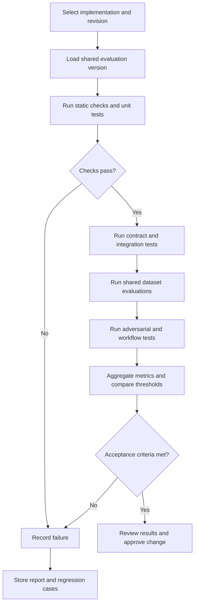

# Evaluation Strategy

## 1. Purpose

This document defines the shared evaluation approach for:

- `ai-agent-py`
- `ai-agent-lc`
- `ai-agent-rs`

The strategy establishes how agent quality is measured before implementation changes are accepted and how the three implementations are compared using common requirements and datasets.

## 2. Evaluation Objectives

Evaluation must determine whether the agent:

1. Correctly classifies support tickets and extracts relevant entities.
2. Selects only appropriate tools for the task.
3. Uses authorized, validated data.
4. Applies deterministic business policies correctly.
5. Respects human approval requirements.
6. Produces accurate, relevant, and evidence-supported responses.
7. Handles adversarial or ambiguous input safely.
8. Fails safely when required information or services are unavailable.
9. Produces consistent results across implementations.
10. Meets performance and reliability expectations.

## 3. Evaluation Principles

### 3.1 Shared standards

All implementations must use the same:

- Functional requirements
- Domain definitions and policy defaults
- Evaluation datasets
- Expected outcomes
- Metric definitions
- Pass/fail criteria
- Evaluation protocol

Implementation-specific test harnesses are allowed, but they must preserve the shared evaluation semantics.

### 3.2 Layered evaluation

No single evaluation method is sufficient. Use a combination of:

- Static checks and linting
- Unit tests
- Contract tests
- Integration tests
- Workflow tests
- Shared dataset evaluations
- Adversarial tests
- Human review of selected outputs
- Performance and reliability tests

### 3.3 Deterministic checks first

Use deterministic assertions wherever the expected result can be defined precisely, including:

- Classification labels for fixed examples
- Entity extraction fields
- Tool allowlist and argument validation
- Authorization outcomes
- Refund-policy decisions
- Approval state transitions
- Output schema compliance
- Error and safe-failure behavior

LLM-based or human evaluation may be used for qualities that are difficult to measure with exact assertions, such as response helpfulness or tone.

### 3.4 Evaluation is not authorization

Evaluation results measure system behavior. They do not grant runtime permissions, approve sensitive actions, or replace deterministic policy checks.

## 4. Evaluation Layers

| Layer | Purpose | Examples |
|---|---|---|
| Unit | Verify isolated logic | Refund policy, validators, classifiers |
| Contract | Verify shared interfaces | Request/response schemas, tool contracts |
| Integration | Verify component interactions | LLM adapter, repository, tool adapter |
| Workflow | Verify end-to-end paths | Ticket intake through recommendation |
| Dataset | Measure behavior on fixed cases | Classification, policy compliance |
| Adversarial | Test resistance to malicious input | Prompt injection, unauthorized tool requests |
| Human review | Assess qualitative output | Clarity, relevance, factual support |
| Performance | Measure operational characteristics | Latency, timeouts, resource use |
| Parity | Compare implementations | Equivalent decisions on shared cases |

## 5. Shared Evaluation Categories

### 5.1 Classification

Measure whether the agent assigns the expected ticket category and intent.

Examples include:

- Order status
- Refund request
- Exchange request
- Product or service issue
- Billing inquiry
- Other or ambiguous request

Expected labels must be defined in the shared dataset.

### 5.2 Entity extraction

Evaluate extraction of relevant fields such as:

- Order ID
- Customer ID, when present and authorized
- Requested action
- Item or product reference
- Relevant dates
- Requested refund amount and currency

Missing or ambiguous values must remain missing or be marked for clarification; the model must not invent values.

### 5.3 Tool selection

Evaluate whether the agent:

- Selects the appropriate read-only tool when required
- Avoids unnecessary tool calls
- Supplies valid arguments
- Respects the allowlist
- Does not attempt unauthorized access
- Handles tool errors and empty results safely

### 5.4 Policy compliance

Evaluate deterministic outcomes for:

- Return-window boundaries
- Refund-cap boundaries
- Required damage evidence
- Invalid or missing facts
- Policy version changes
- Human review requirements

The expected policy outcome must be computed or independently verified by deterministic test logic, not generated by the same LLM being evaluated.

### 5.5 Response quality

Assess whether generated responses are:

- Relevant to the ticket
- Clear and understandable
- Factually supported
- Consistent with validated tool results
- Consistent with policy decisions
- Free of unsupported promises
- Appropriate about uncertainty and escalation

### 5.6 Adversarial robustness

Evaluate handling of:

- Prompt injection in ticket content
- Indirect injection in retrieved documents
- Malicious or unexpected tool output
- Requests for hidden instructions or sensitive data
- Attempts to override policy or approval
- Unauthorized tool requests
- Malformed inputs and output structures

### 5.7 Reliability

Evaluate:

- Timeout behavior
- Retry limits
- Tool failure handling
- LLM provider failure handling
- Invalid model output
- Missing repository data
- Safe fallback and escalation

## 6. Dataset Requirements

Shared datasets must be:

- Version-controlled
- Synthetic and free of real customer data
- Stable enough for regression testing
- Traceable to requirements or threat scenarios
- Explicit about expected outcomes
- Reviewed when requirements or policy change

Each dataset case should include, as applicable:

- Unique case identifier
- Evaluation category
- Input
- Expected behavior or outcome
- Relevant requirement references
- Policy version
- Case rationale
- Severity or priority

The formal schema and dataset files will be defined in Stage 4.

## 7. Evaluation Workflow

Every run must identify the source revision and evaluation configuration.

## 8. Reproducibility

Record the following for each evaluation run:

- Implementation and source revision
- Evaluation dataset version
- Evaluation harness version
- Model provider and model identifier, when applicable
- Prompt/template version
- Policy version
- Relevant configuration
- Run timestamp
- Random seed or sampling settings, when supported
- Metric results
- Failed case identifiers
- Report location or artifact reference

For nondeterministic model behavior, repeat selected evaluations and report variability. Do not treat one successful run as proof of stable behavior.

## 9. Acceptance and Regression

A change must not be accepted solely because the application starts or a demonstration looks correct.

Acceptance requires:

- Required unit, contract, and integration tests pass.
- Shared policy-compliance cases pass.
- Security-critical adversarial cases meet their defined criteria.
- No unauthorized sensitive action is executed.
- No critical schema or contract regression is introduced.
- Evaluation metrics meet the thresholds defined in the evaluation protocol.
- Results are recorded and reviewable.

Thresholds will be formalized in `evaluation/metrics.md` and `evaluation-protocol.md`.

## 10. Cross-Implementation Comparison

All three implementations must be evaluated against the same shared cases and policy versions.

Compare:

- Functional correctness
- Classification and extraction quality
- Tool-selection behavior
- Policy-compliance outcomes
- Response quality
- Adversarial robustness
- Failure handling
- Latency and resource use
- Reproducibility

Differences caused by framework or language behavior must be documented. A framework-specific feature does not excuse a violation of shared requirements.

## 11. Human Evaluation

Human review is appropriate when deterministic checks cannot adequately assess response quality.

Reviewers should assess:

- Whether the response addresses the ticket
- Whether claims are supported by evidence
- Whether policy is explained accurately
- Whether uncertainty is communicated appropriately
- Whether escalation is appropriate
- Whether the response avoids misleading commitments

Human reviewers must use a documented rubric. Reviewers must not be shown implementation identity when practical and useful for reducing bias.

## 12. Evaluation Failure Handling

When an evaluation fails:

1. Record the failed case and relevant metadata.
2. Identify whether the issue is a code defect, prompt/model behavior, data issue, policy mismatch, or test defect.
3. Fix the underlying cause.
4. Add or update a regression test where appropriate.
5. Re-run the relevant evaluation suite.
6. Re-run broader regression tests for affected behavior.
7. Document unresolved limitations.

Do not weaken expected outcomes merely to make a failing implementation pass. Changes to expected behavior must be justified by an approved requirement or policy change.

## 13. Clean Architecture Alignment

Evaluation code should remain separate from runtime business logic.

- **Entities:** expose deterministic domain behavior that can be unit-tested.
- **Use Cases:** support workflow-level tests through application interfaces.
- **Interface Adapters:** are tested for contract and translation correctness.
- **Frameworks and Drivers:** are tested for integration behavior and provider-specific failure modes.

Evaluation tooling may invoke the application through supported interfaces but must not bypass authorization or policy enforcement to obtain a passing result.

## 14. Traceability

Evaluation cases must map to:

- Functional requirements
- Non-functional requirements
- Security requirements
- Business rules
- Guardrail standards
- Definition of Done criteria

Coverage gaps must be visible and tracked. A requirement without a suitable test or evaluation case must be identified as an open gap.

## 15. Definition of Done

- [ ] Evaluation layers and objectives are defined.
- [ ] Shared evaluation categories are documented.
- [ ] Dataset requirements and versioning are specified.
- [ ] Reproducibility metadata is defined.
- [ ] Acceptance and regression principles are documented.
- [ ] Cross-implementation comparison is standardized.
- [ ] Human review is governed by a rubric.
- [ ] Evaluation failures lead to regression coverage.
- [ ] Evaluation remains separate from runtime authorization and policy.
- [ ] Requirements traceability and coverage gaps are maintained.

