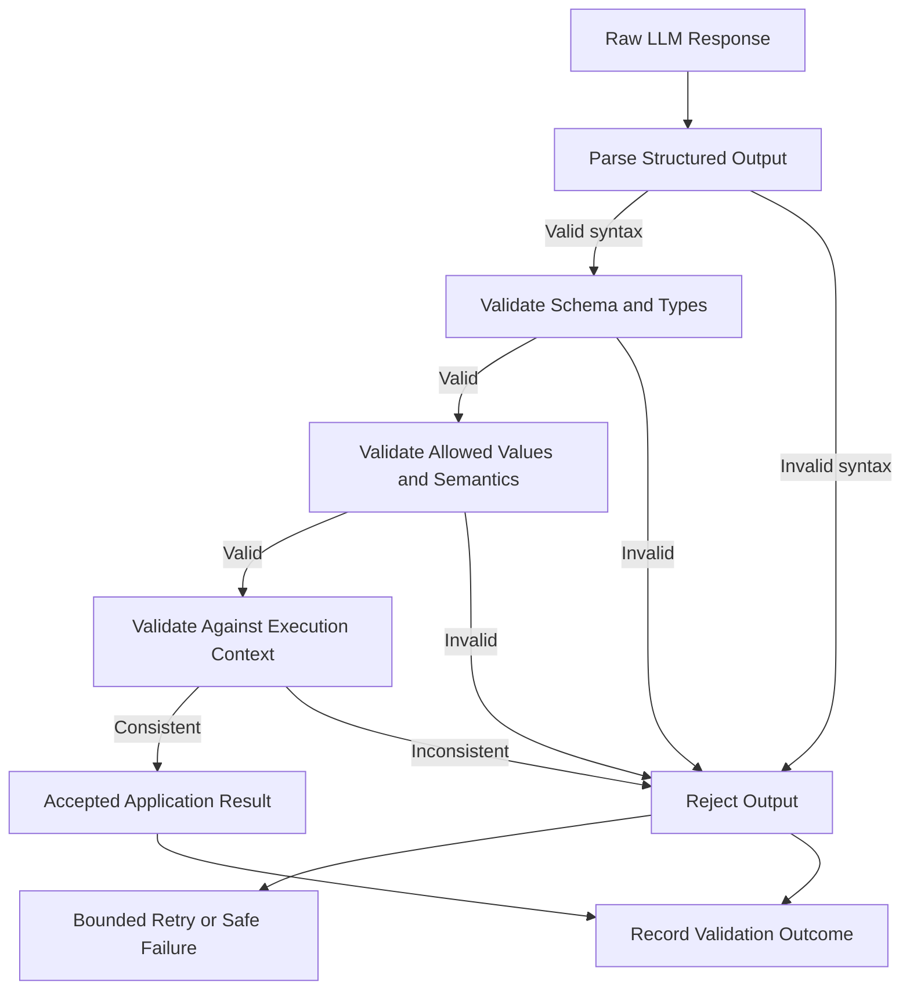

# Output Validation Standards

## 1. Purpose

Define validation requirements for structured outputs generated by the LLM and results returned by tools or application workflows.

All model-generated content is untrusted until it passes validation.

## 2. Output Validation Pipeline



## 3. Classification Output

Expected conceptual structure:

```json
{
  "intent": "DELIVERY_ISSUE",
  "entities": {
    "order_id": "4821"
  },
  "confidence": 0.91,
  "reason_code": "DELIVERY_STATUS_REQUEST"
}
```

### Validation rules

| Field | Rule |
|---|---|
| `intent` | Must match the shared `AgentIntent` enum |
| `entities` | Must match the defined entity schema |
| `order_id` | Optional; if present, must match the identifier format |
| `confidence` | Numeric value in the inclusive range 0.0–1.0 |
| `reason_code` | Must use an approved reason-code format |

Additional semantic rules:

- The output must not contain unsupported intent values.
- Missing confidence must be handled according to the shared contract.
- An extracted order ID must not be treated as verified until checked against application data.
- Confidence does not grant permission to execute a tool.
- The model cannot set authorization or approval state.

## 4. Suggested Response Output

Expected conceptual structure:

```json
{
  "response_text": "I can help check the delivery status of your order.",
  "claims": [
    {
      "claim_type": "ORDER_STATUS",
      "evidence_reference": "ORDER-4821"
    }
  ],
  "requires_human_review": true
}
```

### Validation rules

- `response_text` must be a string within the configured length limit.
- Claims must use approved claim types.
- Evidence references must refer to information available in the current execution context.
- The response must not claim that an action has occurred unless the application has verified that outcome.
- The response must not contradict deterministic policy results.
- The model cannot independently set approval status.
- The application determines whether human review is required.
- Unsupported claims must be removed or cause the response to be rejected.

The `requires_human_review` field is illustrative. The authoritative approval requirement is computed by application policy, not accepted from the LLM.

## 5. Tool Proposal Output

If an LLM proposes a tool invocation, the proposal must be validated before execution.

Validation requirements:

1. Tool name exists in the allowlist.
2. Tool is permitted for the current workflow.
3. Arguments match the tool schema.
4. Identifiers are valid.
5. The authenticated user is authorized.
6. The operation is within the initial read-only scope.
7. The request does not attempt to modify permissions or business policy.

The LLM proposal itself is not an authorization decision.

## 6. Refund Assessment Validation

Refund eligibility is produced by deterministic application logic, not by the LLM.

Expected conceptual structure:

```json
{
  "eligibility": "PENDING_REVIEW",
  "reason_codes": [
    "POLICY_DATA_UNAVAILABLE"
  ],
  "policy_reference": "REFUND-POLICY-V1",
  "assessed_amount": {
    "amount": "0.00",
    "currency": "CAD"
  }
}
```

Validation requirements:

- Eligibility must match the shared `RefundEligibility` enum.
- Reason codes must be recognized.
- Policy reference must identify the policy used.
- Money must include amount and currency.
- Amount must use the shared decimal-string representation.
- Assessment must be consistent with the deterministic policy result.
- A failed or unavailable policy evaluation must not produce `ELIGIBLE`.
- Model-generated refund assessments must not be accepted as authoritative.

## 7. Tool Result Validation

Tool results must be validated before entering the application workflow.

Requirements:

- Validate response structure and types.
- Validate resource identifiers.
- Validate status values.
- Distinguish not-found results from service failures.
- Reject unexpected or malformed responses.
- Treat external service content as untrusted.
- Preserve the tool execution status and failure reason.
- Do not treat a timeout or error response as a successful result.

## 8. Application Result Validation

Before returning an execution result, validate:

- Execution status is a valid enum.
- Ticket and execution identifiers are present.
- Decision and assessment references are consistent.
- Approval status matches the approval workflow state.
- Suggested response is present only when successfully generated and validated.
- Error information follows the shared error contract.
- No sensitive internal details are exposed.

## 9. Retry and Safe Failure

Retry only when the failure is transient and retry is permitted.

Rules:

- Use a bounded retry count.
- Do not retry schema or semantic failures indefinitely.
- Do not retry authorization denials as if they were transient.
- Record each failed attempt.
- If validation still fails, stop the affected workflow path.
- Return a controlled error, pending-review state, or escalation outcome.
- Never silently substitute a fabricated value.

## 10. Validation Testing Requirements

Tests must cover:

- Malformed JSON.
- Missing required output fields.
- Incorrect field types.
- Unsupported enum values.
- Confidence outside the allowed range.
- Invalid identifiers.
- Contradictory or unsupported claims.
- Tool proposals outside the allowlist.
- Tool arguments that violate schemas.
- Refund assessments inconsistent with policy.
- Invalid tool result structures.
- Retry exhaustion.
- Safe failure and escalation outcomes.

## 11. Implementation Mapping

| Concern | Python | LangChain / LangGraph | Rust |
|---|---|---|---|
| Schema validation | Typed models and validators | Typed models and validators | Serde types and validation |
| Semantic validation | Application validators | Application validators | Application validators |
| Tool validation | Tool execution service | Tool execution service outside model decisions | Tool execution service |
| Domain invariants | Entities and domain services | Entities and domain services | Domain types and services |
| Failure handling | Use cases and orchestrator | Use cases and graph workflow | Application workflow |

Libraries may differ, but the shared validation behavior must remain consistent.

## 12. Definition of Done

- [ ] LLM outputs are treated as untrusted.
- [ ] Structured output validation pipeline is documented.
- [ ] Classification output rules are defined.
- [ ] Suggested response validation rules are defined.
- [ ] Tool proposal validation is defined.
- [ ] Refund assessment authority remains deterministic.
- [ ] Tool results are validated before use.
- [ ] Application results are validated before return.
- [ ] Retry and safe failure rules are documented.
- [ ] Shared validation tests are specified.
- [ ] Implementation mapping is included.
