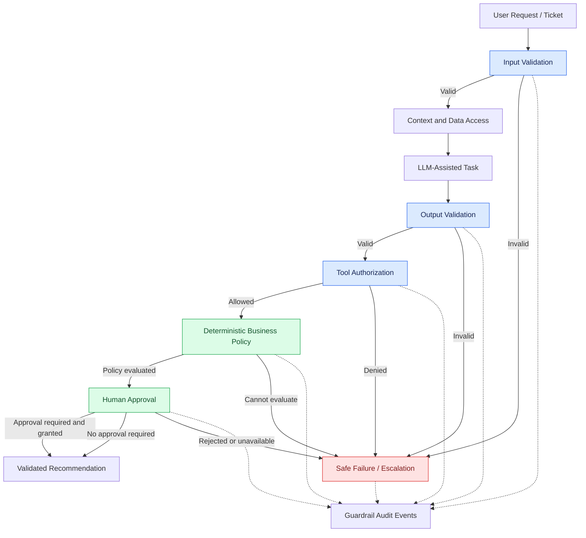

# Guardrail Strategy

## 1. Purpose

This document defines the shared guardrail strategy for the AI Customer Support and Ticket Resolution Agent portfolio.

The strategy applies to:

- `ai-agent-py`
- `ai-agent-lc`
- `ai-agent-rs`

Guardrails constrain agent behavior and protect business, security, data, and workflow boundaries.

Guardrails must be enforced by deterministic application code wherever possible. Prompts may guide model behavior but must not be treated as security or authorization controls.

## 2. Scope

The guardrail strategy covers:

1. Input validation.
2. LLM output validation.
3. Prompt-injection defense.
4. Tool authorization and execution constraints.
5. Deterministic business policy enforcement.
6. Human approval.
7. Safe failure and escalation.
8. Guardrail observability.
9. Guardrail evaluation and testing.

Detailed implementation standards are maintained in:

```text
engineering/guardrails/
├── strategy.md
├── input-validation.md
├── output-validation.md
├── prompt-injection.md
└── policy-enforcement.md
```

## 3. Guardrail Principles

### G-001: Defense in Depth

Use multiple independent controls across the request lifecycle. No single prompt, classifier, or validation step is sufficient.

### G-002: Deterministic Enforcement

Security permissions, business rules, workflow state transitions, and approval requirements must be enforced by application code.

### G-003: Least Privilege

The agent receives only the data and tool capabilities required for the current task.

### G-004: Treat Model Output as Untrusted

All LLM outputs must be validated before they influence application state, tool execution, or user-visible recommendations.

### G-005: Treat User Content as Untrusted

Ticket descriptions, attachments, retrieved documents, and customer-provided text are data—not trusted instructions.

### G-006: Fail Safely

If a required validation, authorization, or policy check cannot complete, the application must not assume success.

### G-007: Human Oversight

Sensitive recommendations must follow the approval policy. Approval state and reviewer authorization are enforced by application code.

### G-008: Auditability

Significant guardrail decisions must be recorded with execution context and reason codes.

### G-009: Shared Behavior

All three implementations must satisfy the same guardrail requirements and shared evaluation cases.

## 4. Guardrail Architecture



The diagram represents conceptual control points. Actual execution order may vary by use case, but required controls cannot be bypassed.

## 5. Guardrail Categories

| Category | Purpose | Enforcement |
|---|---|---|
| Input validation | Reject malformed or excessive requests | Deterministic validators |
| Output validation | Ensure LLM output matches expected schema and constraints | Schema and semantic validation |
| Prompt-injection defense | Prevent untrusted content from changing agent instructions | Prompt separation, least privilege, application controls |
| Tool authorization | Restrict operations to permitted tools and arguments | Application authorization service |
| Business policy | Enforce refund and ticket rules | Domain services and use cases |
| Human approval | Gate sensitive recommendations | Approval workflow and authorization |
| Safe failure | Prevent invalid or uncertain outcomes from proceeding | Explicit error and escalation paths |
| Auditability | Preserve evidence of important decisions | Structured audit events |

## 6. Input Validation

All external input must be validated before entering application workflows.

Validation includes:

- Required fields.
- Field types.
- Maximum lengths.
- Identifier formats.
- Allowed enum values.
- Request size limits.
- Attachment metadata and type restrictions, where supported.
- Unexpected or unsupported fields.

Input validation must not rely solely on prompt instructions.

Invalid requests must return a structured application error and must not start an agent execution.

See `input-validation.md` for detailed requirements.

## 7. LLM Output Validation

LLM output must be treated as untrusted.

Validation includes:

- Required output schema.
- Field types and allowed values.
- Confidence range validation.
- Entity identifier format.
- Allowed intent values.
- Refusal or uncertainty handling.
- Semantic consistency checks.
- Rejection of unsupported tool names or arguments.

Invalid output must not be used to update domain state or authorize tool execution.

See `output-validation.md` for detailed requirements.

## 8. Prompt-Injection Defense

The system must assume that ticket text, attachments, and retrieved content may contain malicious or irrelevant instructions.

Required controls:

- Clearly separate system instructions from untrusted content.
- Avoid treating retrieved content as executable instructions.
- Limit the information supplied to the model.
- Validate all model-proposed actions.
- Restrict tools through an application-controlled allowlist.
- Do not expose secrets in prompts.
- Do not allow model output to change user permissions or policy configuration.
- Evaluate adversarial ticket content using shared test cases.

Prompt-level instructions are supplementary controls. They do not replace application authorization or validation.

See `prompt-injection.md` for detailed requirements.

## 9. Tool Authorization and Execution

Tool execution must be controlled by the application.

### Initial allowed tool capabilities

- Customer lookup.
- Order lookup.
- Business policy lookup.
- Ticket context retrieval.

These capabilities are read-only in the initial portfolio scope.

### Required controls

1. Validate the requested tool name.
2. Validate arguments against a defined schema.
3. Verify the authenticated user's permission.
4. Verify the tool is allowed for the current workflow.
5. Enforce data scope and identifier constraints.
6. Apply timeout and bounded retry policies.
7. Record the invocation outcome.
8. Reject unsupported operations.

The LLM may propose a tool call but cannot authorize or execute it directly.

## 10. Deterministic Business Policy Enforcement

Refund eligibility must be calculated by deterministic domain logic.

Initial shared policy:

| Policy | Value |
|---|---|
| Return window | 30 calendar days |
| Maximum refund assessment amount | CAD 100 |
| Damaged goods | Image verification required |

Required behavior:

- The LLM cannot override the refund assessment.
- Missing policy data must not produce an eligible result.
- Policy evaluation failure must produce a controlled unavailable or review outcome.
- Policy version or reference must be retained with the assessment.
- Eligibility and reason codes must be explainable.
- Assessment is a recommendation and does not execute a financial transaction.

See `policy-enforcement.md` for detailed requirements.

## 11. Human Approval

Sensitive recommendations must follow the shared approval policy.

Required controls:

- Approval request must be explicitly created.
- Approval must be associated with the relevant execution and recommendation.
- Reviewer identity must be authenticated.
- Reviewer permission must be checked by application code.
- Only valid pending requests can transition to approved or rejected.
- Rejected requests cannot authorize sensitive actions.
- Approval decisions must be auditable.
- Approval does not trigger a real financial transaction.

## 12. Safe Failure and Escalation

The application must fail safely when a required control cannot complete.

| Failure | Required behavior |
|---|---|
| Input validation fails | Reject request |
| LLM output is invalid | Reject output; retry only within configured limits |
| Tool authorization fails | Deny operation and record event |
| Tool times out | Return controlled failure |
| Policy data is unavailable | Do not declare eligibility |
| Approval service is unavailable | Keep action pending or escalate |
| Required audit event cannot be recorded | Apply the documented audit-failure policy |
| Confidence or evidence is insufficient | Request review or escalate |

A failure must not be converted into a successful business decision.

## 13. Guardrail Observability

Each significant guardrail event should include:

- Execution ID.
- Ticket ID where applicable.
- Guardrail category.
- Decision: allowed, denied, rejected, failed, or escalated.
- Reason code.
- Timestamp.
- Relevant component or tool name.
- Model and prompt version where applicable.
- Correlation ID.

Avoid logging unnecessary ticket content, customer information, credentials, or secrets.

## 14. Guardrail Evaluation

Guardrails must be tested using shared datasets and repeatable evaluation procedures.

Evaluation categories:

- Invalid input rejection.
- Malformed output rejection.
- Tool authorization enforcement.
- Prompt-injection resistance.
- Deterministic policy compliance.
- Approval enforcement.
- Safe failure behavior.
- Sensitive data exposure checks.

Evaluation results must identify:

- Dataset version.
- Implementation version.
- Model and prompt version, when applicable.
- Test outcome.
- Failure category.
- Relevant execution identifiers.

## 15. Implementation Mapping

| Guardrail | `ai-agent-py` | `ai-agent-lc` | `ai-agent-rs` |
|---|---|---|---|
| Input validation | Python validators | Python validators | Rust validators |
| Output validation | Schema and semantic validators | Schema and semantic validators | Typed and semantic validators |
| Prompt-injection defense | Application-controlled prompts and tools | LangGraph workflow plus application controls | Application-controlled prompts and tools |
| Tool authorization | Authorization service | Authorization service outside model decisions | Authorization service |
| Business policy | Domain policy service | Domain policy service | Domain policy service |
| Approval | Approval use case | Approval use case with workflow pause/resume | Approval use case |
| Audit | Structured logging adapter | Structured logging adapter | Structured logging adapter |

Framework features may support guardrail implementation, but they do not replace shared application-level requirements.

## 16. Risks and Mitigations

| Risk | Mitigation |
|---|---|
| Prompt instructions are treated as security controls | Enforce permissions and policy in application code |
| LLM output bypasses validation | Validate every model response before use |
| Tool access expands without review | Maintain an explicit allowlist and review changes |
| Business rules diverge across implementations | Use shared policy specifications and tests |
| Failures produce unsafe outcomes | Define explicit safe failure behavior |
| Audit logs expose sensitive data | Apply data minimization and log redaction |
| Guardrails reduce usability | Measure false positives and review failure cases |

## 17. Related Documents

- `specifications/02-requirements.md`
- `specifications/04-domain-model.md`
- `specifications/05-agent-contracts.md`
- `specifications/06-architecture.md`
- `architecture/component-diagram.md`
- `architecture/sequence-diagrams.md`
- `engineering/security/threat-model.md`
- `engineering/testing/test-strategy.md`
- `engineering/evaluation/strategy.md`

## 18. Definition of Done

- [ ] Shared guardrail principles are documented.
- [ ] Guardrail categories and enforcement mechanisms are defined.
- [ ] Input and output validation requirements are identified.
- [ ] Prompt-injection defense is documented.
- [ ] Tool authorization is application-controlled.
- [ ] Refund policy enforcement remains deterministic.
- [ ] Human approval requirements are explicit.
- [ ] Safe failure and escalation behavior is defined.
- [ ] Guardrail observability requirements are documented.
- [ ] Shared evaluation requirements are defined.
- [ ] All three implementations are mapped to the strategy.
- [ ] The document is consistent with Clean Architecture.
- [ ] No real financial transaction execution is introduced.
