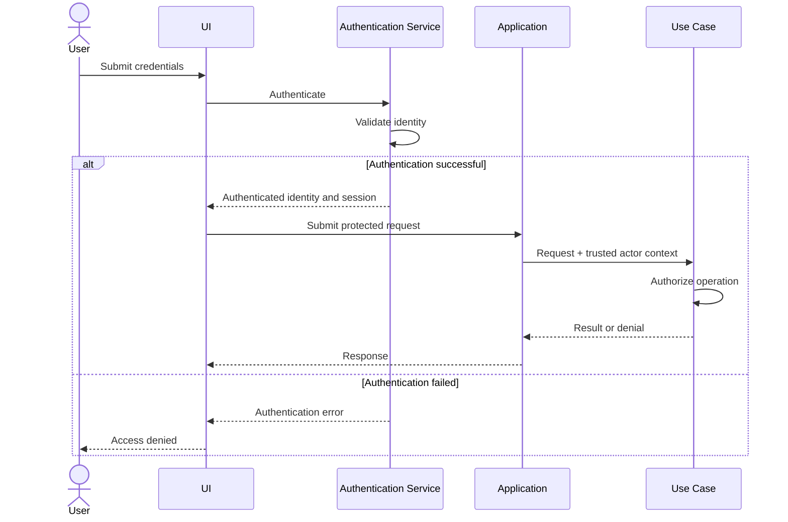
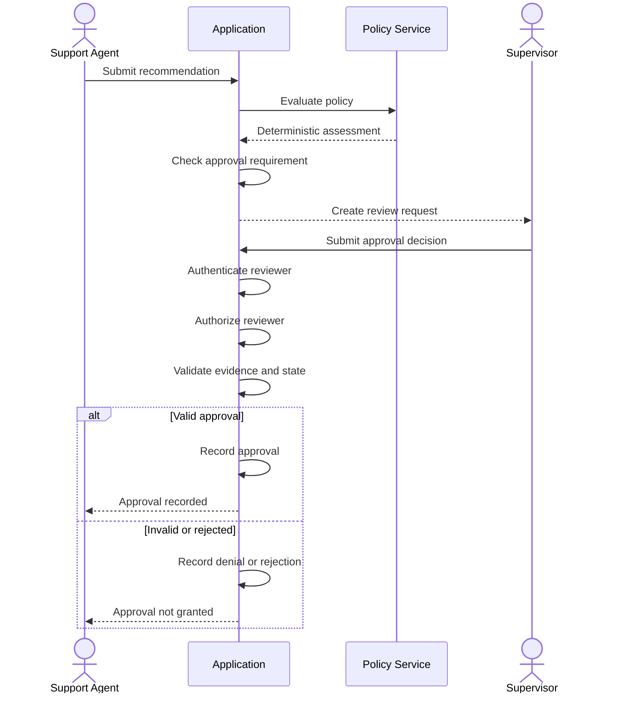

# Authentication and Authorization Standard

## 1. Purpose

This document defines shared authentication and authorization requirements for:

- `ai-agent-py`
- `ai-agent-lc`
- `ai-agent-rs`

It establishes:

- User identity and authentication
- Role-based access control (RBAC)
- Resource-level authorization
- Permission enforcement
- Human approval authority
- Security auditing
- Cross-implementation consistency

## 2. Scope

The initial application defines three roles:

- `SUPPORT_AGENT`
- `SUPERVISOR`
- `ADMIN`

The application uses synthetic data and an application-level authorization model.

The initial portfolio does not require integration with a real corporate identity provider.

Authentication and authorization are separate concerns:

- **Authentication:** Who is the user?
- **Authorization:** What is that user permitted to do?

A successfully authenticated user may still be denied access to an operation.

## 3. Authentication Requirements

### 3.1 Identity

Each authenticated user must have:

- Unique user ID
- Username or login identifier
- Assigned role or roles
- Account status
- Authentication context
- Session or token expiration information

User IDs must be stable and must not be inferred from ticket content.

### 3.2 Authentication flow



### 3.3 Authentication rules

- Reject invalid credentials.
- Reject inactive or disabled accounts.
- Enforce session expiration.
- Do not trust identity fields submitted by the client.
- Do not accept an LLM-generated identity or role.
- Do not expose credential details in error messages.
- Store credentials securely if local authentication is implemented.
- Never commit credentials or secrets to Git.

### 3.4 Token-based authentication

If JWT is used, validate:

- Signature
- Issuer
- Audience
- Expiration
- Not-before time, when applicable
- Required subject identifier
- Required claims

Do not accept an unsigned or improperly validated token.

A JWT role claim must be issued by a trusted authentication component and validated by the application.

The JWT implementation and signing-key management details will be finalized during implementation planning.

## 4. Role Definitions

### 4.1 SUPPORT_AGENT

A support agent handles ordinary customer-support work.

Responsibilities:

- View assigned or authorized tickets.
- View customer and order information within permitted scope.
- Submit tickets for agent analysis.
- View classifications and extracted entities.
- View refund eligibility recommendations.
- Generate and review suggested responses.
- Submit cases for supervisor review.

Restrictions:

- Cannot modify business policy.
- Cannot approve their own sensitive recommendations.
- Cannot administer users or roles.
- Cannot access unrelated customer records.
- Cannot execute financial transactions.

### 4.2 SUPERVISOR

A supervisor handles escalated cases and approval workflows.

Responsibilities:

- View authorized support tickets.
- Review agent recommendations.
- Review policy assessments and supporting evidence.
- Approve or reject eligible requests requiring human review.
- View relevant audit history.
- Escalate cases for further investigation.

Restrictions:

- Cannot modify system-wide security configuration unless separately granted.
- Cannot bypass deterministic business policy.
- Cannot approve a case without required evidence.
- Cannot approve an operation outside their assigned scope.
- Cannot execute real financial transactions in the initial portfolio.

### 4.3 ADMIN

An administrator manages application configuration and access.

Responsibilities:

- Manage user accounts.
- Assign and revoke roles.
- Disable accounts.
- Review security and audit events.
- Manage approved application configuration.
- Manage policy configuration through a controlled review process.

Restrictions:

- Administrative access does not automatically override business-policy requirements.
- Changes to sensitive policy configuration must be versioned and auditable.
- Administrative privileges do not authorize bypassing required approval.
- Admins must not use their role to fabricate customer or approval records.

## 5. Role-Permission Matrix

| Capability | SUPPORT_AGENT | SUPERVISOR | ADMIN |
|---|---|---|---|
| Authenticate | Yes | Yes | Yes |
| View authorized tickets | Yes | Yes | Yes |
| Submit ticket for analysis | Yes | Yes | Yes |
| View authorized customer data | Yes | Yes | Yes |
| View order information | Yes | Yes | Yes |
| View agent recommendations | Yes | Yes | Yes |
| Generate suggested response | Yes | Yes | Yes |
| Submit escalation | Yes | Yes | Yes |
| Review approval requests | No | Yes | No by default |
| Approve eligible requests | No | Yes | No by default |
| Reject approval requests | No | Yes | No by default |
| View security audit events | No | Scoped | Yes |
| Manage user accounts | No | No | Yes |
| Assign roles | No | No | Yes |
| Manage policy configuration | No | No | Controlled admin permission |
| Execute real refunds | No | No | No |

The ADMIN role does not automatically grant supervisor approval authority. Approval permissions must be explicitly assigned according to the separation-of-duties policy.

## 6. Resource-Level Authorization

Role checks alone are insufficient.

The application must verify that the authenticated actor can access the requested resource.

Examples:

- A support agent may view only tickets within their assigned scope.
- A supervisor may review tickets within their authorized team or escalation scope.
- A user must not access another customer's order by changing an identifier.
- An approval reviewer must have permission to review the referenced case.

Resource authorization must be enforced by application use cases and relevant repository access logic.

Never assume that possession of a ticket ID, customer ID, or order ID grants access.

## 7. Authorization Model

Use RBAC with resource-level restrictions.

A permission is evaluated using:

- Authenticated actor ID
- Actor roles
- Requested action
- Resource type
- Resource identifier
- Resource ownership or assigned scope
- Workflow state
- Relevant approval requirements

Conceptual authorization rule:

```python
def authorize(actor, action, resource):
    if not actor.is_authenticated:
        return False

    if not actor.is_active:
        return False

    if not role_allows(actor.roles, action):
        return False

    if not resource_scope_allows(actor, resource):
        return False

    return True
```

This is illustrative pseudocode. The production implementation must use validated identity context and explicit permission rules.

## 8. Authorization Enforcement

Every protected operation must be checked before execution.

Required sequence:

1. Authenticate the request.
2. Construct trusted actor context.
3. Validate the requested operation.
4. Resolve the resource.
5. Evaluate role permissions.
6. Evaluate resource-level access.
7. Validate workflow state.
8. Validate policy and approval requirements.
9. Execute the permitted operation.
10. Record the authorization outcome.

Authorization must be enforced independently of:

- UI button visibility
- Prompt instructions
- Model-generated tool calls
- LLM responses
- User-supplied role fields

## 9. Tool Authorization

LLM tool selection is not authorization.

Before executing a tool, the application must verify:

- The tool is allowlisted.
- The actor is authorized.
- The tool arguments are valid.
- The target resource is within the actor's scope.
- The operation is allowed in the current workflow state.
- Required policy conditions are satisfied.
- Required approval exists.

The initial tool set is read-only.

Examples:

| Tool | SUPPORT_AGENT | SUPERVISOR | ADMIN |
|---|---|---|---|
| `get_order` | Scoped | Scoped | Scoped |
| `get_customer` | Scoped | Scoped | Scoped |
| `get_ticket` | Scoped | Scoped | Scoped |
| `get_policy` | Yes | Yes | Yes |
| `get_approval_history` | No | Scoped | Yes |

Tool permissions must be enforced by application logic rather than relying on model tool descriptions.

## 10. Human Approval Authorization

Sensitive recommendations requiring approval must be reviewed by an authorized human.

Requirements:

- Only authorized supervisors may approve or reject requests by default.
- The reviewer identity must come from trusted authentication context.
- Approval must reference the relevant case and action.
- The reviewer must have access to the referenced case.
- Required evidence and policy assessment must be available.
- The requester must not approve their own sensitive request.
- Approval state must be maintained by the application.
- Rejected or invalid approvals must not authorize subsequent actions.

### Approval sequence



## 11. Separation of Duties

The following rules apply:

- A support agent cannot approve their own sensitive recommendation.
- A supervisor cannot approve a case outside their authorized scope.
- An administrator cannot bypass deterministic policy.
- Role assignment and approval decisions must be separate permissions.
- Approval must be associated with a specific action and case.
- Material changes to a case require re-evaluation and, where necessary, re-approval.

## 12. Error Handling

Use consistent authorization errors.

| Condition | Expected result |
|---|---|
| No authenticated identity | Authentication required |
| Invalid credentials | Authentication failure |
| Expired session | Authentication required again |
| Missing permission | Access denied |
| Out-of-scope resource | Access denied |
| Invalid workflow state | Operation rejected |
| Missing approval | Approval required |
| Rejected approval | Operation denied |

Avoid disclosing whether an unrelated customer or restricted resource exists when the actor is not authorized to access it.

## 13. Audit Requirements

Record security-relevant events:

- Authentication success and failure
- Session expiration
- Authorization success and denial
- Role assignment and revocation
- Account activation and deactivation
- Approval creation
- Approval decisions
- Policy configuration changes
- Sensitive resource access
- Tool execution authorization outcomes

Audit events should include:

- Event ID
- Timestamp
- Actor ID
- Actor role context
- Action
- Resource reference
- Outcome
- Correlation ID
- Relevant policy or application version

Do not record passwords, tokens, or unnecessary personal information.

## 14. Clean Architecture Responsibilities

| Layer | Responsibility |
|---|---|
| Entities | Maintain valid identity-related and approval-related domain state |
| Use Cases | Enforce role permissions, resource scope, and workflow authorization |
| Interface Adapters | Extract and validate trusted identity context |
| Frameworks and Drivers | Implement authentication libraries, token validation, UI integration, and technical security mechanisms |

Authorization policies must remain testable independently of the UI and LLM provider.

## 15. Implementation Mapping

### `ai-agent-py`

- Define typed actor and permission structures.
- Implement authentication context extraction in interface adapters.
- Enforce authorization in application use cases.
- Keep role and resource-scope checks outside prompt construction.
- Test permission matrices and denial behavior.

### `ai-agent-lc`

- Pass trusted actor context through application workflow state.
- Do not let the model populate or change actor identity and roles.
- Validate permissions before tool nodes execute.
- Validate supervisor identity and approval state during graph interrupt/resume.
- Do not treat a graph transition as an authorization decision.

### `ai-agent-rs`

- Use typed identity, role, and permission structures.
- Validate authentication claims at the application boundary.
- Implement explicit authorization services.
- Enforce resource scope before repository access.
- Use typed approval transitions and explicit error results.

## 16. Testing Requirements

Tests must cover:

- Successful authentication
- Invalid credentials
- Disabled users
- Expired tokens or sessions
- Missing roles
- Incorrect role permissions
- Cross-customer resource access attempts
- Support agent attempting supervisor operations
- Unauthorized tool execution
- Self-approval attempts
- Approval by an out-of-scope reviewer
- Role assignment by an unauthorized actor
- Policy configuration changes without required authorization
- LLM attempts to alter identity or role context

All critical authorization tests must have deterministic expected results.

## 17. Traceability

This standard supports:

- Security requirements for authentication and authorization
- Tool-security requirements
- Human approval requirements
- Prompt injection defenses
- Policy enforcement
- Threat model risks TH-001, TH-004, TH-006, TH-009, TH-010, and TH-011
- Evaluation strategy and security metrics

## 18. Definition of Done

- [ ] Three shared roles are defined.
- [ ] Authentication requirements are documented.
- [ ] RBAC permissions are documented.
- [ ] Resource-level authorization is required.
- [ ] Authorization is enforced outside the LLM.
- [ ] Tool execution requires authorization.
- [ ] Human approval authority is defined.
- [ ] Separation-of-duties requirements are documented.
- [ ] Authorization failures are handled consistently.
- [ ] Security audit requirements are defined.
- [ ] All implementations follow equivalent authorization semantics.
- [ ] Authentication and authorization tests are specified.

