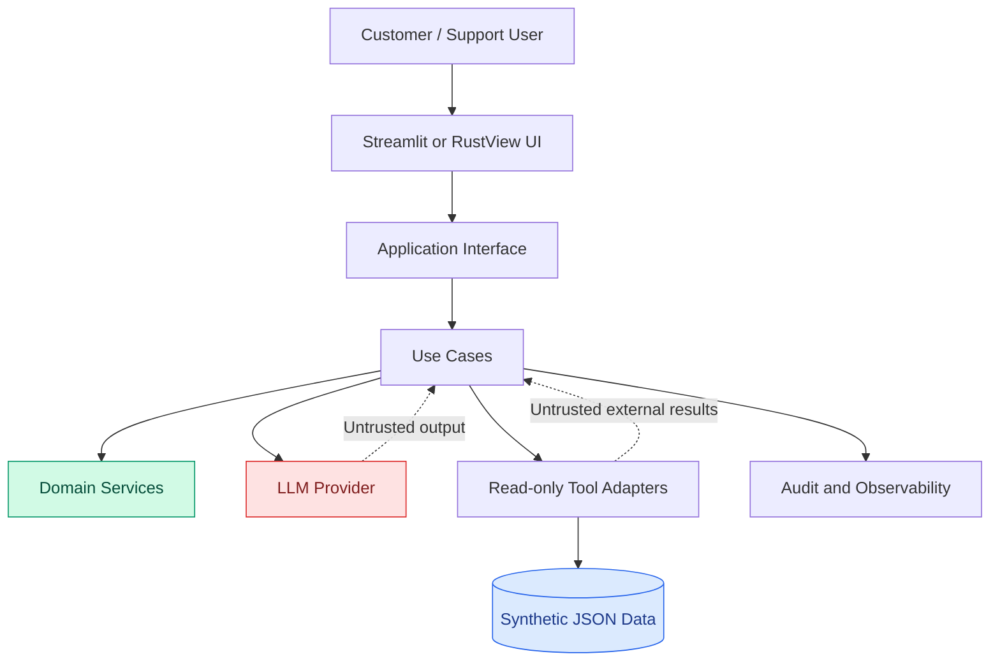

# Security Threat Model

## 1. Purpose

This document defines the security threat model for the AI Customer Support & Ticket Resolution Agent.

It identifies:

- Assets requiring protection
- Threat actors and their capabilities
- Trust boundaries
- Attack surfaces
- Potential security threats
- Risk levels and mitigations
- Security testing requirements

The threat model applies to all implementations:

- `ai-agent-py`
- `ai-agent-lc`
- `ai-agent-rs`

## 2. System Security Context

The application receives customer tickets, retrieves synthetic customer and order information, evaluates business policies, and generates support recommendations.

The architecture is a Modular Monolith using Clean Architecture.

### Security boundaries

The diagram illustrates logical boundaries, not a separate microservice deployment.

## 3. Assets to Protect

| Asset | Description | Security objective |
|---|---|---|
| Customer records | Synthetic customer profiles | Confidentiality and integrity |
| Order records | Order and delivery information | Confidentiality and integrity |
| Ticket records | Customer support requests | Confidentiality and integrity |
| Business policies | Refund and eligibility rules | Integrity |
| User identities | Authenticated actor information | Authenticity |
| User roles | Support, supervisor, administrator permissions | Integrity |
| Agent prompts | Internal instructions and configuration | Confidentiality and integrity |
| LLM responses | Model-generated recommendations | Integrity and validation |
| Tool execution records | Tool arguments and results | Authorization and auditability |
| Approval records | Human review decisions | Integrity and accountability |
| Audit events | Security and workflow history | Integrity and traceability |
| API credentials | Provider and integration secrets | Confidentiality |

## 4. Threat Actors

### 4.1 External customer

A customer may submit malicious, malformed, misleading, or unauthorized requests through ticket content.

Potential objectives:

- Obtain information outside their authorization scope.
- Manipulate the agent into ignoring its intended task.
- Obtain an unsupported refund recommendation.
- Influence tool selection or application behavior.

### 4.2 Malicious or compromised support user

An authenticated user may attempt to access records or functionality beyond their assigned role.

Potential objectives:

- Access unrelated customer records.
- Bypass supervisor approval.
- Manipulate ticket or approval state.
- Access administrative functionality.

### 4.3 Compromised external dependency

An LLM provider, retrieval source, or external integration may return malformed, manipulated, or unexpected content.

Potential objectives:

- Influence model behavior.
- Return incorrect or unauthorized information.
- Expose sensitive data through an integration.
- Disrupt application execution.

### 4.4 Insider or configuration error

An administrator or developer may unintentionally introduce insecure configuration or incorrect policy values.

Potential consequences:

- Excessive permissions.
- Incorrect refund limits.
- Exposed credentials.
- Missing audit records.
- Inconsistent policy versions.

## 5. STRIDE Threat Classification

STRIDE is used to categorize threats:

- **S — Spoofing:** Impersonating an identity.
- **T — Tampering:** Unauthorized modification of data or state.
- **R — Repudiation:** Denying an action without sufficient audit evidence.
- **I — Information Disclosure:** Exposing information to unauthorized parties.
- **D — Denial of Service:** Preventing legitimate system use.
- **E — Elevation of Privilege:** Obtaining permissions beyond those assigned.

## 6. Threat Register

| ID | STRIDE | Threat | Impact | Initial risk |
|---|---|---|---|---|
| TH-001 | Spoofing | Forged or improperly trusted user identity | Unauthorized access | High |
| TH-002 | Tampering | Modification of ticket or order identifiers | Incorrect data access | High |
| TH-003 | Repudiation | Missing records for important decisions | Weak accountability | Medium |
| TH-004 | Information Disclosure | Exposure of another customer's records | Privacy breach | Critical |
| TH-005 | Denial of Service | Excessive requests or expensive model calls | Service disruption | High |
| TH-006 | Elevation of Privilege | Support user obtains supervisor capabilities | Unauthorized actions | Critical |
| TH-007 | Tampering | Customer content attempts to override policy | Incorrect recommendation | Critical |
| TH-008 | Information Disclosure | Prompt injection requests hidden instructions or sensitive data | Information exposure | High |
| TH-009 | Tampering | Model-generated tool arguments contain unauthorized identifiers | Incorrect data access | Critical |
| TH-010 | Elevation of Privilege | Tool execution bypasses application authorization | Unauthorized operation | Critical |
| TH-011 | Tampering | Approval state is changed without authorized review | Approval integrity failure | Critical |
| TH-012 | Information Disclosure | Secrets are included in prompts or logs | Credential exposure | Critical |
| TH-013 | Tampering | Retrieved content contains indirect prompt injection | Unsafe model behavior | High |
| TH-014 | Denial of Service | LLM or tool provider becomes unavailable | Workflow failure | Medium |
| TH-015 | Repudiation | Audit events are incomplete or inconsistent | Investigation difficulty | High |
| TH-016 | Tampering | Policy configuration changes without review | Incorrect eligibility decisions | Critical |
| TH-017 | Information Disclosure | Logs contain unnecessary personal information | Privacy exposure | High |
| TH-018 | Denial of Service | Malformed inputs consume excessive resources | Application disruption | Medium |

Risk levels are initial qualitative assessments. They must be reviewed as the implementation and deployment environment become clearer.

## 7. Trust Boundaries

### Boundary 1: User to UI

**Input:** Ticket data, user actions, authentication context.

Risks:
- Malformed input
- Identity spoofing
- Unauthorized access
- Excessive request volume

Controls:
- Input validation
- Authentication
- Role checks
- Request limits
- Safe error responses

### Boundary 2: UI to Application

**Input:** Application requests and user-selected operations.

Risks:
- Modified identifiers
- Unauthorized operation requests
- Invalid workflow transitions

Controls:
- Request schema validation
- Authorization in application use cases
- Resource ownership and scope checks
- Workflow state validation

### Boundary 3: Application to LLM

**Input:** Task instructions and selected context.

Risks:
- Prompt injection
- Sensitive-data exposure
- Unreliable model output
- Unexpected provider behavior

Controls:
- Context minimization
- Untrusted-content delimiting
- Secret exclusion
- Output schema validation
- Provider abstraction
- Timeout and retry limits

### Boundary 4: Application to Tools and Data

**Input:** Tool requests and repository queries.

Risks:
- Unauthorized record access
- Invalid arguments
- Excessive data retrieval
- Incorrect or malformed results

Controls:
- Tool allowlist
- Argument validation
- Authorization
- Data-scope enforcement
- Read-only initial scope
- Result validation

### Boundary 5: Application to Audit

**Input:** Execution events and security-relevant metadata.

Risks:
- Missing events
- Sensitive-data leakage
- Unauthorized log access
- Inconsistent event records

Controls:
- Structured logging
- Sensitive-data minimization
- Access restrictions
- Correlation identifiers
- Retention policies

## 8. Attack Surface Inventory

| Attack surface | Entry point | Required controls |
|---|---|---|
| Ticket submission | UI/API | Validation, size limits |
| Authentication | Login/session boundary | Identity verification |
| Authorization | Application operations | RBAC and resource checks |
| LLM prompts | Model adapter | Context minimization |
| LLM responses | Model adapter | Schema and semantic validation |
| Tool calls | Application use cases | Allowlist and authorization |
| Retrieved documents | Retrieval adapter | Source and content validation |
| Policy configuration | Application configuration | Versioning and review |
| Approval workflow | Reviewer interface | Identity and state validation |
| Logs | Observability component | Access control and redaction |
| Dependencies | Build and runtime | Dependency review and updates |
| Deployment configuration | Environment and container setup | Secret management and least privilege |

## 9. Security Mitigation Strategy

### 9.1 Identity and access management

- Authenticate users before protected operations.
- Derive roles from trusted authentication context.
- Enforce permissions in application logic.
- Do not trust role values supplied by the UI or LLM.
- Apply resource-level access restrictions.

### 9.2 Data protection

- Use synthetic data only.
- Avoid unnecessary personal information in prompts.
- Never include secrets in model context.
- Restrict access to customer and order records.
- Protect audit information.
- Define retention and deletion rules.

### 9.3 LLM security

- Treat model output as untrusted.
- Apply prompt injection defenses.
- Validate structured responses.
- Limit model context.
- Restrict tool access.
- Do not expose internal instructions or credentials.

### 9.4 Business-policy integrity

- Implement policy evaluation deterministically.
- Version policy configuration.
- Test policy boundaries.
- Require human approval for sensitive actions.
- Prevent model-generated decisions from changing authoritative policy results.

### 9.5 Application security

- Validate inputs at application boundaries.
- Use typed and validated data structures.
- Handle errors without exposing implementation details.
- Apply request and resource limits.
- Keep dependencies maintained.
- Store secrets outside source control.

## 10. Initial Security Risk Prioritization

### Critical risks

The following risks block acceptance if demonstrated:

- Unauthorized access to another customer's records.
- Execution of an unauthorized tool operation.
- Policy bypass affecting authoritative eligibility.
- Approval bypass.
- Sensitive credential or customer-data exposure.
- Unauthorized policy configuration changes.

### High risks

These require correction or documented mitigation before acceptance:

- Prompt injection that influences noncritical behavior.
- Excessive model or tool resource consumption.
- Missing audit events.
- Weak input validation.
- Excessive user permissions.

### Medium risks

These require monitoring and planned remediation:

- Noncritical provider availability failures.
- Recoverable integration failures.
- Noncritical logging gaps.
- Performance degradation within acceptable operational limits.

## 11. Security Testing Strategy

Security tests must include:

| Test area | Example test objective |
|---|---|
| Authentication | Reject unauthenticated protected requests |
| Authorization | Deny a support user access to supervisor functions |
| Resource isolation | Prevent cross-customer record access |
| Input validation | Reject malformed ticket and identifier values |
| Prompt injection | Ensure ticket instructions cannot change application policy |
| Tool security | Deny unapproved or invalid tool requests |
| Policy integrity | Preserve deterministic refund decisions |
| Approval integrity | Reject missing or invalid approval |
| Data protection | Verify secrets are excluded from model context and logs |
| Auditability | Verify critical decisions produce traceable events |
| Availability | Verify bounded behavior during provider failures |
| Dependency security | Review vulnerable dependencies |

All critical security tests must have deterministic expected outcomes.

## 12. Residual Risks

Some risks cannot be fully eliminated.

Examples:

- LLM provider outages or behavior changes.
- Novel prompt injection techniques.
- Incorrect synthetic policy configuration.
- Bugs in third-party dependencies.
- Human reviewer mistakes.
- Incomplete threat identification.

Residual risks must be documented and reviewed. The architecture reduces their impact through restricted model authority, deterministic enforcement, least privilege, and human approval.

## 13. Clean Architecture Alignment

| Layer | Security responsibility |
|---|---|
| Entities | Maintain domain invariants and valid state |
| Use Cases | Enforce authorization, policy, approval, and workflow requirements |
| Interface Adapters | Validate external requests, tool results, and model outputs |
| Frameworks and Drivers | Implement authentication integrations, LLM access, UI, logging, and technical security controls |

Security decisions must remain enforceable independently of the LLM provider and UI framework.

## 14. Traceability

This threat model supports:

- Functional requirements for ticket processing and approval
- Security requirements for authentication, authorization, and data protection
- Guardrail strategy
- Input and output validation
- Prompt injection defense
- Policy enforcement
- Evaluation strategy and metrics
- Definition of Done

Threat identifiers should be referenced in relevant security tests and future remediation records.

## 15. Definition of Done

- [ ] Protected assets are identified.
- [ ] Threat actors and capabilities are documented.
- [ ] STRIDE threat categories are considered.
- [ ] Trust boundaries are documented.
- [ ] Attack surfaces are inventoried.
- [ ] Threats have initial risk ratings.
- [ ] Mitigations are mapped to threat categories.
- [ ] Critical security risks have explicit acceptance rules.
- [ ] Security testing requirements are documented.
- [ ] Residual risks are identified.
- [ ] Threats are traceable to requirements and tests.

