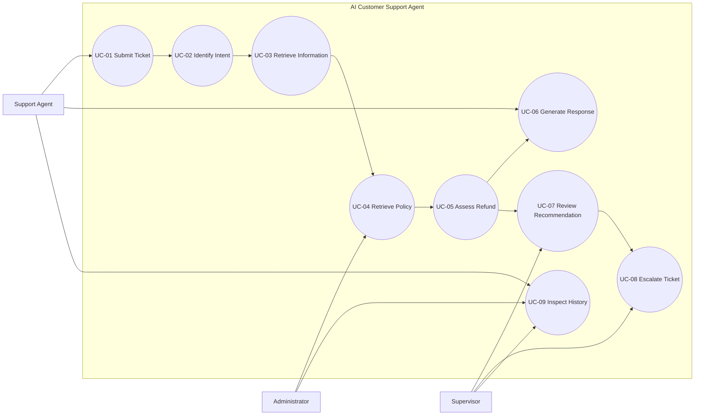
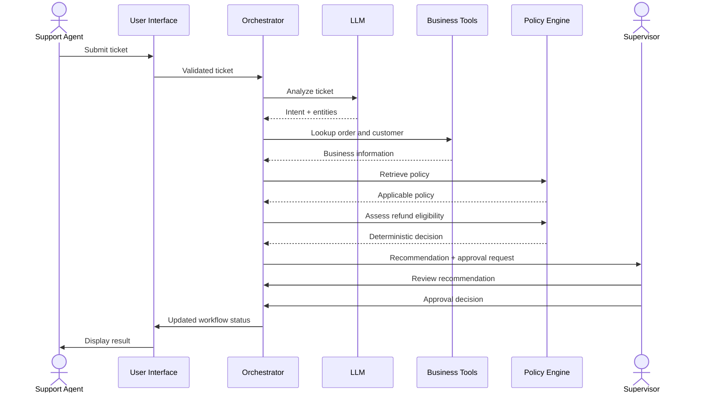

# Use Case Specifications

## 1. Purpose

This document describes the functional workflows of the AI Customer Support & Ticket Resolution Agent.

It translates the requirements defined in `02-requirements.md` into concrete interactions between users and system components.

The use cases apply to all three implementations:

- `ai-agent-py`
- `ai-agent-lc`
- `ai-agent-rs`

## 2. Actors

| Actor | Type | Responsibility |
|---|---|---|
| Support Agent | Primary | Submits tickets and reviews recommendations |
| Supervisor | Primary | Reviews sensitive recommendations |
| Administrator | Primary | Manages system policies and configuration |
| AI Agent | System | Analyzes tickets and coordinates workflows |
| Policy Engine | System | Evaluates deterministic business rules |
| Tool Services | System | Retrieve authorized business information |

## 3. Use Case Diagram



### 3.1 Understand the Core Workflow

The following sequence shows how a refund request moves through the system.



> **Note:** The LLM does not make the refund eligibility decision. The Policy Engine does.

## 4. UC-01: Submit and Classify Ticket

### Description

A support agent submits a customer ticket. The system validates the ticket and initiates an agent execution.

### Actors

- Primary: Support Agent
- Supporting: AI Agent

### Preconditions

- The support agent has access to the application.
- The ticket contains the required fields.
- The system is available.

### Trigger

The support agent submits a new ticket.

### Input

```json
{
  "ticket_id": "TICKET-001",
  "customer_id": "CUSTOMER-100",
  "subject": "Order not received",
  "description": "My order #4821 has not arrived.",
  "channel": "web"
}
```

### Main Success Flow

1. Support agent opens the ticket submission interface.
2. Support agent enters ticket information.
3. System validates the ticket structure.
4. System creates an execution ID.
5. System records the ticket.
6. System initiates agent processing.
7. System returns the execution status.

### Alternative Flows

**A1 — Optional information missing**

1. The system identifies a missing optional field.
2. The system applies the documented default or records the field as unavailable.
3. Processing continues when required fields are valid.

### Exception Flows

**E1 — Invalid ticket**

1. The system detects invalid or missing required fields.
2. The system rejects the submission.
3. The system returns a structured validation error.

**E2 — Duplicate ticket identifier**

1. The system detects an existing ticket ID.
2. The system rejects the duplicate submission.

### Postconditions

- A valid ticket is recorded.
- An execution ID is assigned.
- Processing status is available.

### Related Requirements

FR-001, FR-002, FR-003, FR-004, NFR-001.

---

## 5. UC-02: Identify Customer Intent

### Description

The AI Agent analyzes a ticket, determines the customer's intent, classifies the ticket, and extracts relevant entities.

### Actors

- Primary: AI Agent
- Supporting: Support Agent

### Preconditions

- A valid ticket exists.
- An agent execution has started.

### Trigger

The orchestrator starts ticket analysis.

### Main Success Flow

1. The orchestrator retrieves the ticket.
2. The agent prepares the classification input.
3. The intent detection component analyzes the ticket.
4. The agent identifies the customer intent.
5. The agent extracts relevant entities.
6. The system validates the structured result.
7. The system stores the classification.

### Example Input

```text
My order #4821 has not arrived.
I would like to know whether I can get a refund.
```

### Expected Output

```json
{
  "intent": "refund_request",
  "category": "delivery_issue",
  "entities": {
    "order_id": "4821"
  },
  "confidence": 0.96
}
```

The confidence value is illustrative, not a guaranteed model result.

### Alternative Flows

**A1 — Unknown intent**

1. The agent cannot confidently identify an intent.
2. The agent returns `unknown`.
3. The system requests human review or clarification.

**A2 — Multiple intents**

1. The agent detects multiple customer requests.
2. The agent identifies the relevant intents.
3. The system records the multiple-intent result for orchestration.

**A3 — Missing order ID**

1. The agent identifies a refund or order inquiry.
2. No order ID is available.
3. The system marks order information as required.
4. The agent requests clarification or escalates.

### Exception Flows

**E1 — Invalid LLM output**

1. The generated classification fails schema validation.
2. The system rejects the invalid output.
3. The system records the validation failure.
4. The workflow requests a controlled retry or human review.

### Postconditions

- Intent classification is stored.
- Extracted entities are available.
- Uncertain classifications are explicitly identified.

### Related Requirements

FR-006, FR-007, FR-008, FR-009, FR-010, FR-024.

---

## 6. UC-03: Retrieve Customer and Order Information

### Description

The system retrieves customer and order information using authorized read-only tools.

### Actors

- Primary: AI Agent
- Supporting: Tool Services

### Preconditions

- Ticket classification is available.
- Required identifiers are available.
- The relevant lookup tool is authorized.

### Trigger

The orchestrator determines that additional business information is required.

### Main Success Flow

1. The orchestrator identifies required information.
2. The system selects the appropriate lookup tool.
3. The application validates the tool arguments.
4. The security component verifies authorization.
5. The tool retrieves the requested information.
6. The tool returns a structured result.
7. The system validates the result.
8. The execution context is updated.

### Example Order Result

```json
{
  "order_id": "4821",
  "customer_id": "CUSTOMER-100",
  "status": "shipped",
  "delivery_status": "delayed",
  "total_amount": 85.00,
  "currency": "USD"
}
```

### Alternative Flows

**A1 — Order not found**

1. The lookup returns no matching order.
2. The system records `not_found`.
3. The agent does not invent order information.
4. The workflow requests clarification or escalation.

**A2 — Customer lookup unavailable**

1. The customer service returns an unavailable result.
2. The system records the tool failure.
3. The workflow does not assume the customer exists or is verified.

### Exception Flows

**E1 — Unauthorized tool**

1. A tool invocation fails authorization.
2. The application blocks execution.
3. The system records a security event.

**E2 — Tool timeout**

1. The lookup exceeds its configured timeout.
2. The system records a timeout.
3. The workflow follows its retry or escalation policy.

### Postconditions

- Retrieved information is available to authorized application components.
- Tool execution results are recorded.
- Missing or unavailable information remains explicitly identified.

### Related Requirements

FR-011, FR-012, FR-014, FR-015, SEC-003, SEC-004, NFR-002.

---

## 7. UC-04: Retrieve Business Policy

### Description

The system retrieves the business policies applicable to the customer's request.

### Actors

- Primary: AI Agent
- Supporting: Tool Services, Administrator

### Preconditions

- The ticket intent is available.
- Relevant business context has been retrieved.

### Trigger

The orchestrator determines that a policy evaluation is required.

### Main Success Flow

1. The orchestrator identifies the policy category.
2. The system requests the applicable policy.
3. The policy lookup tool validates the request.
4. The system retrieves the policy definition.
5. The policy result is validated.
6. The policy information is added to the execution context.

### Alternative Flows

**A1 — No applicable policy**

1. No matching policy is found.
2. The system records that no policy was found.
3. The request is routed for clarification or human review.

**A2 — Multiple policies**

1. Multiple policy definitions are returned.
2. The policy service determines applicable precedence according to documented rules.
3. Ambiguous conflicts are escalated rather than resolved through LLM guessing.

### Exception Flows

**E1 — Policy service unavailable**

1. The policy lookup fails.
2. The system records the failure.
3. The system does not proceed with an assumed policy decision.

### Postconditions

- Applicable policy information is available, or its absence is recorded.
- Policy retrieval is traceable.

### Related Requirements

FR-013, FR-016, FR-017, BR-001, BR-007.

---

## 8. UC-05: Assess Refund Eligibility

### Description

The system evaluates whether a customer request satisfies refund eligibility rules.

The assessment is deterministic and independent of the LLM.

### Actors

- Primary: AI Agent
- Supporting: Policy Engine, Tool Services

### Preconditions

- The ticket intent is identified as a refund request.
- Required order information is available.
- Applicable policy information is available.

### Trigger

The orchestrator requests a refund eligibility assessment.

### Main Success Flow

1. The orchestrator prepares the refund assessment input.
2. The application validates the input.
3. The Policy Engine evaluates the applicable business rules.
4. The Policy Engine produces a structured decision.
5. The system records the decision and reason codes.
6. The orchestrator determines the next workflow state.
7. If sensitive action approval is required, the workflow creates an approval request.
8. The agent prepares an appropriate recommendation.

### Example Input

```json
{
  "order_id": "4821",
  "order_status": "shipped",
  "delivery_status": "delayed",
  "order_total": 85.00,
  "currency": "USD",
  "request_type": "refund_request"
}
```

### Example Output

```json
{
  "eligibility": "pending_review",
  "reason_codes": [
    "HUMAN_REVIEW_REQUIRED"
  ],
  "requires_human_approval": true
}
```

This is an illustrative result. Actual eligibility depends on the finalized business policy.

### Alternative Flows

**A1 — Eligible**

1. The policy engine determines that eligibility conditions are satisfied.
2. The system records `eligible`.
3. The system prepares the recommendation.
4. Any required approval remains mandatory before sensitive execution.

**A2 — Ineligible**

1. The policy engine determines that eligibility conditions are not satisfied.
2. The system records `ineligible`.
3. The system records the reason.
4. The agent prepares an explanation.

**A3 — Insufficient information**

1. Required information is missing.
2. The policy engine returns `pending_review`.
3. The system identifies missing information.
4. The workflow requests clarification or human review.

### Exception Flows

**E1 — Policy evaluation failure**

1. The policy engine fails.
2. The system records the failure.
3. The system must not treat the request as eligible.
4. The workflow stops or escalates.

**E2 — Invalid assessment input**

1. Input validation fails.
2. The system rejects the assessment request.
3. The system records a validation error.

### Postconditions

- A deterministic assessment result is recorded.
- Decision reasons are available.
- No LLM-generated output can override the result.
- Sensitive execution remains blocked until required approval.

### Related Requirements

FR-016, FR-017, FR-018, FR-019, FR-020, BR-001, BR-002, BR-006, BR-007.

---

## 9. UC-06: Generate Suggested Customer Response

### Description

The agent prepares a customer-facing response using validated ticket information and business decisions.

### Actors

- Primary: AI Agent
- Supporting: Support Agent

### Preconditions

- Ticket classification is available.
- Relevant business information has been retrieved where required.
- Applicable policy decisions are available or explicitly marked unavailable.

### Trigger

The orchestrator requests response generation.

### Main Success Flow

1. The system prepares a response-generation context.
2. The LLM generates a suggested response.
3. The application validates the output structure.
4. The system checks the response against available evidence and policy decisions.
5. The system rejects unsupported claims.
6. The response is displayed to the support agent.
7. The response is associated with the execution history.

### Alternative Flows

**A1 — Missing information**

1. The agent identifies insufficient information.
2. The response requests clarification or explains the limitation.
3. The system avoids unsupported claims.

**A2 — Pending approval**

1. The refund assessment requires approval.
2. The response communicates that the request is under review.
3. The response does not claim that a refund has been completed.

### Exception Flows

**E1 — Invalid response**

1. The response fails validation.
2. The system rejects the response.
3. A controlled retry or human review is requested.

### Postconditions

- A validated suggested response is available.
- The response is grounded in available information.
- The response does not claim that an unexecuted action has occurred.

### Related Requirements

FR-021, FR-022, FR-023, FR-024.

---

## 10. UC-07: Review and Approve Recommendation

### Description

A supervisor reviews a sensitive recommendation and approves or rejects it.

In the initial portfolio, approval is an internal workflow decision. It does not initiate a real financial transaction.

### Actors

- Primary: Supervisor
- Supporting: AI Agent, Approval Manager

### Preconditions

- An approval request exists.
- The supervisor is authorized to review it.
- The recommendation has a recorded execution context.

### Trigger

The supervisor opens a pending approval request.

### Main Success Flow

1. The supervisor opens the approval interface.
2. The system retrieves the recommendation.
3. The system displays relevant evidence and policy decisions.
4. The supervisor reviews the request.
5. The supervisor approves or rejects the recommendation.
6. The application validates the supervisor's authorization.
7. The approval manager records the decision and reviewer identity.
8. The execution workflow is updated.
9. The system records an audit event.

### Alternative Flows

**A1 — Approved**

1. The supervisor approves the recommendation.
2. The system records `approved`.
3. The workflow can continue according to the approved action's permitted scope.

**A2 — Rejected**

1. The supervisor rejects the recommendation.
2. The system records `rejected`.
3. The workflow prevents the rejected action from proceeding.

**A3 — More information required**

1. The supervisor identifies missing information.
2. The supervisor requests clarification.
3. The ticket returns to an appropriate review state.

### Exception Flows

**E1 — Unauthorized reviewer**

1. The system identifies insufficient permissions.
2. The approval action is rejected.
3. A security event is recorded.

**E2 — Approval request already processed**

1. The supervisor attempts to process a completed approval request.
2. The system rejects the duplicate decision.
3. The existing decision remains unchanged.

### Postconditions

- The approval decision is recorded.
- The reviewer is identified.
- The workflow state is updated.
- Rejected actions cannot proceed.

### Related Requirements

FR-025, FR-026, FR-027, FR-028, BR-003, BR-008, SEC-008.

---

## 11. UC-08: Escalate Ticket

### Description

The system routes unresolved, exceptional, or high-risk tickets for additional human review.

### Actors

- Primary: Support Agent
- Supporting: Supervisor, AI Agent

### Preconditions

- A ticket exists.
- The ticket has an unresolved condition or requires escalation.

### Trigger

The system or support agent initiates escalation.

### Main Success Flow

1. The system identifies the escalation condition.
2. The system records the escalation reason.
3. The ticket status changes to `escalated`.
4. The system creates an escalation record.
5. The supervisor can inspect the ticket.
6. The system records the escalation event.

### Alternative Flows

**A1 — Manual escalation**

1. The support agent identifies a difficult case.
2. The support agent requests escalation.
3. The system records the request.

**A2 — Automatic escalation**

1. A policy or workflow condition requires human review.
2. The system initiates escalation.
3. The reason is recorded.

### Exception Flows

**E1 — Escalation service unavailable**

1. The escalation operation fails.
2. The system preserves the current ticket state.
3. The failure is recorded.
4. The support agent is informed.

### Postconditions

- Escalation status and reason are recorded.
- The case is available for human review.

### Related Requirements

FR-005, FR-029, FR-030, NFR-002.

---

## 12. UC-09: Inspect Execution History

### Description

Authorized users inspect the history of an agent execution, including decisions, tool invocations, approval outcomes, and errors.

### Actors

- Primary: Support Agent, Supervisor, Administrator
- Supporting: Observability and Audit Components

### Preconditions

- An execution record exists.
- The requesting user is authorized to inspect it.

### Trigger

The user opens an execution record.

### Main Success Flow

1. The user selects an execution.
2. The system validates access permissions.
3. The system retrieves the execution record.
4. The system retrieves associated agent decisions.
5. The system retrieves tool execution records.
6. The system retrieves policy and approval events.
7. The system presents the execution timeline.

### Alternative Flows

**A1 — Partial execution history**

1. Some telemetry is unavailable.
2. The system displays the available records.
3. Missing information is clearly identified.

### Exception Flows

**E1 — Unauthorized access**

1. The system denies access.
2. The system records the security event.

**E2 — Execution not found**

1. The system cannot locate the requested execution.
2. The system returns a structured not-found result.

### Postconditions

- Authorized users can inspect available execution history.
- Access and relevant audit events are recorded.

### Related Requirements

FR-030, FR-031, FR-032, FR-033, SEC-007.

---

## 13. Use Case to Requirement Traceability

| Use Case | Related Requirements |
|---|---|
| UC-01 | FR-001 to FR-004, NFR-001 |
| UC-02 | FR-006 to FR-010, FR-024 |
| UC-03 | FR-011, FR-012, FR-014, FR-015, SEC-003, SEC-004 |
| UC-04 | FR-013, FR-016, FR-017 |
| UC-05 | FR-016 to FR-020, BR-001, BR-002, BR-006, BR-007 |
| UC-06 | FR-021 to FR-024 |
| UC-07 | FR-025 to FR-028, BR-003, BR-008 |
| UC-08 | FR-005, FR-029, FR-030 |
| UC-09 | FR-030 to FR-033, SEC-007 |

## 14. Shared Workflow Rules

All three implementations must respect the following:

1. Ticket data must be validated before processing.
2. Intent detection must produce structured output.
3. Tool arguments must be validated before execution.
4. Tool authorization must be enforced outside the LLM.
5. Business policies must be evaluated deterministically.
6. Failed policy evaluation must never imply eligibility.
7. Sensitive actions must require human approval.
8. Generated responses must not fabricate business information.
9. Execution and approval decisions must be traceable.
10. No real financial transaction is executed in the initial portfolio.

## 15. Future Use Cases

The following capabilities are intentionally deferred:

- Multiple simultaneous customer identities.
- Multilingual ticket processing.
- Customer satisfaction prediction.
- Advanced ticket prioritization.
- Production CRM integrations.
- Real payment gateway integration.
- Autonomous account modification.

These may be considered after the initial three implementations have been evaluated.
