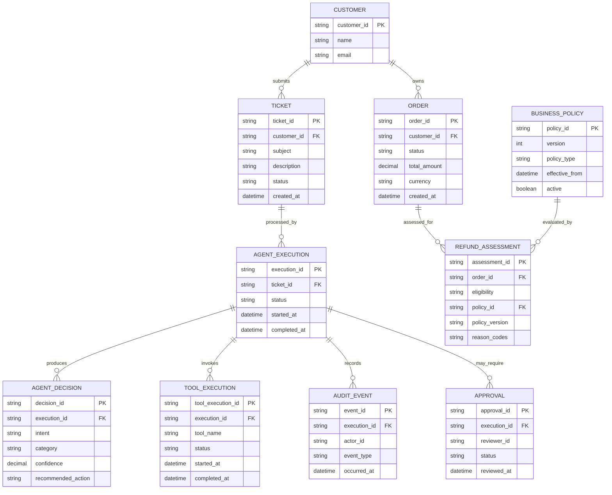

# Domain Model

## 1. Purpose

This document defines the business domain that is shared by all three implementations:

- `ai-agent-py` — Plain Python.
- `ai-agent-lc` — LangChain + LangGraph.
- `ai-agent-rs` — Rust.

The domain model defines the business concepts, their attributes, relationships, lifecycle, and rules independently of any programming language or framework.

By the end of this step, the following artifacts are defined:

1. Domain entities.
2. Value objects.
3. Enumerations.
4. Aggregate boundaries.
5. Entity relationships.
6. Business invariants.
7. Entity relationship and class diagrams.

The design applies to all implementations and is independent of UI, LLM provider, framework, and storage technology.

## 2. Problem Statement

The requirements define what the agent must do, but not the business objects it operates on.

Consider this ticket:

> My order #4821 has not arrived.
> I want to know whether I can get a refund.

The system must understand several concepts:

- Customer
- Ticket
- Order
- Agent Execution
- Agent Decision
- Business Policy
- Refund Assessment
- Approval
- Tool Execution
- Audit Event

Without a shared domain model, the Python, LangChain, and Rust implementations could represent the same business concepts differently.

**Solution:** Establish one technology-independent domain model before writing implementation code.

## 3. Domain-Driven Design Concepts

This model uses selected concepts from Domain-Driven Design (DDD).

| Concept | Meaning | Example |
|---|---|---|
| Entity | Object with a unique identity | Ticket |
| Value Object | Object defined by its values | Money |
| Aggregate | Consistency boundary for related objects | Approval |
| Aggregate Root | Entry point for modifying an aggregate | Ticket |
| Domain Service | Business operation not naturally owned by one entity | Refund Policy Evaluation |
| Repository | Abstraction for retrieving and persisting aggregates | TicketRepository |
| Domain Event | Record of an important business occurrence | RefundAssessmentCompleted |

**Important distinction:** Domain model ≠ database schema ≠ API contract. They are related, but they serve different purposes.

## 4. Domain Entities

### 4.1 Core Entities

| Entity | Responsibility |
|---|---|
| Customer | Customer identity and profile |
| Ticket | Customer support request |
| Order | Customer purchase information |
| AgentExecution | One agent processing run |
| AgentDecision | Agent recommendation |
| RefundAssessment | Deterministic eligibility result |
| Approval | Human review decision |
| ToolExecution | Authorized tool invocation record |
| BusinessPolicy | Versioned business rules |
| AuditEvent | Record of significant actions |

## 5. Entity Attributes

| Entity | Important Attributes |
|---|---|
| Customer | `customer_id`, `name`, `email` |
| Ticket | `ticket_id`, `customer_id`, `subject`, `description`, `status`, `created_at` |
| Order | `order_id`, `customer_id`, `status`, `total_amount`, `currency`, `created_at` |
| AgentExecution | `execution_id`, `ticket_id`, `status`, `started_at`, `completed_at` |
| AgentDecision | `decision_id`, `execution_id`, `intent`, `category`, `confidence`, `recommended_action` |
| RefundAssessment | `assessment_id`, `order_id`, `eligibility`, `reason_codes`, `policy_version` |
| BusinessPolicy | `policy_id`, `version`, `policy_type`, `effective_from`, `active` |
| Approval | `approval_id`, `execution_id`, `status`, `reviewer_id`, `reviewed_at` |
| ToolExecution | `tool_execution_id`, `execution_id`, `tool_name`, `status`, `started_at`, `completed_at` |
| AuditEvent | `event_id`, `execution_id`, `actor_id`, `event_type`, `occurred_at` |

These attributes represent the initial conceptual model. Data types and validation constraints are refined when defining the shared agent contracts.

## 6. Value Objects

Value objects have no independent identity. Their meaning comes from their values.

| Value Object | Attributes | Purpose |
|---|---|---|
| Money | `amount`, `currency` | Represent monetary amounts |
| ConfidenceScore | `value` | Represent classification confidence |
| ReasonCode | `code`, `description` | Explain a business decision |
| ExecutionDuration | `milliseconds` | Measure execution time |
| CustomerReference | `customer_id` | Reference a customer |
| OrderReference | `order_id` | Reference an order |

Two `Money` objects are equal when their amounts and currencies are equal.

```json
{
  "amount": 85.00,
  "currency": "USD"
}
```

A monetary value must never be compared across currencies without an explicit conversion policy.

## 7. Enumerations

These enums establish shared values across all implementations.

### TicketStatus

- `OPEN`
- `IN_PROGRESS`
- `PENDING_APPROVAL`
- `RESOLVED`
- `ESCALATED`

### AgentIntent

- `ORDER_INQUIRY`
- `REFUND_REQUEST`
- `DELIVERY_ISSUE`
- `PRODUCT_QUESTION`
- `COMPLAINT`
- `UNKNOWN`

### OrderStatus

- `PLACED`
- `PROCESSING`
- `SHIPPED`
- `DELIVERED`
- `CANCELLED`

### ExecutionStatus

- `PENDING`
- `RUNNING`
- `WAITING_FOR_APPROVAL`
- `COMPLETED`
- `FAILED`
- `ESCALATED`

### RefundEligibility

- `ELIGIBLE`
- `INELIGIBLE`
- `PENDING_REVIEW`

### ApprovalStatus

- `PENDING`
- `APPROVED`
- `REJECTED`
- `CANCELLED`

### ToolExecutionStatus

- `PENDING`
- `RUNNING`
- `SUCCEEDED`
- `FAILED`
- `TIMED_OUT`
- `DENIED`

## 8. Entity Relationship Diagram

The diagram below shows the relationships between the main domain objects.



## 9. Aggregate Boundaries

An aggregate defines a consistency boundary. Related objects should be modified through their aggregate root rather than being changed arbitrarily.

This initial design uses four aggregate roots.

### 9.1 Ticket Aggregate

**Aggregate Root:** `Ticket`

- Ticket
- Ticket status
- Ticket metadata

**Responsibility:** Maintain the lifecycle of a customer support request.

### 9.2 Agent Execution Aggregate

**Aggregate Root:** `AgentExecution`

- AgentExecution
- AgentDecision
- ToolExecution

**Responsibility:** Track one agent processing run and its decisions and tool activity.

### 9.3 Refund Assessment Aggregate

**Aggregate Root:** `RefundAssessment`

- RefundAssessment
- Eligibility result
- Reason codes
- Policy version reference

**Responsibility:** Preserve the result of a deterministic refund evaluation.

### 9.4 Approval Aggregate

**Aggregate Root:** `Approval`

- Approval
- Reviewer identity
- Approval status
- Review timestamp

**Responsibility:** Maintain the human review lifecycle.

`Customer`, `Order`, and `BusinessPolicy` are independently identified entities with their own lifecycle and repository abstractions.

Identifiers are used between aggregates rather than placing every object inside one large aggregate. This avoids unnecessary coupling.

## 10. Domain Services

Some business operations do not naturally belong to a single entity.

| Service | Responsibility |
|---|---|
| RefundPolicyService | Evaluate refund eligibility |
| TicketClassificationPolicy | Validate classification-related business constraints |
| ApprovalPolicyService | Determine approval requirements |
| TicketEscalationPolicy | Determine escalation conditions |

**Important architectural distinction:**

- The LLM identifies intent and proposes actions.
- The application orchestrator coordinates the workflow.
- Domain services enforce business decisions.
- Infrastructure services retrieve external information.

The `RefundPolicyService` must not depend on LangChain, an LLM provider, Streamlit, or RustView.

## 11. Domain Invariants

Invariants are rules that must always remain true.

| ID | Invariant |
|---|---|
| INV-001 | Every ticket has a unique ticket ID. |
| INV-002 | Every agent execution belongs to an existing ticket. |
| INV-003 | An execution cannot be marked completed while required processing is still pending. |
| INV-004 | Refund eligibility must originate from deterministic policy evaluation. |
| INV-005 | An LLM recommendation cannot override a refund assessment. |
| INV-006 | An approval must identify its reviewer. |
| INV-007 | A rejected approval cannot authorize a sensitive action. |
| INV-008 | A failed policy evaluation cannot produce an eligible decision. |
| INV-009 | A denied tool execution must not be treated as successful. |
| INV-010 | Monetary values must include a currency. |
| INV-011 | Policy decisions must retain the policy version used for evaluation. |
| INV-012 | Significant workflow decisions must be traceable. |

## 12. Domain Events

Domain events represent important business occurrences.

| Event | Trigger |
|---|---|
| TicketSubmitted | A new ticket is accepted |
| TicketClassified | Intent classification is recorded |
| OrderRetrieved | Order information is successfully retrieved |
| PolicyRetrieved | Applicable policy information is retrieved |
| RefundAssessed | Refund eligibility evaluation completes |
| ApprovalRequested | Human approval is requested |
| ApprovalGranted | Supervisor approves a recommendation |
| ApprovalRejected | Supervisor rejects a recommendation |
| TicketEscalated | Ticket is escalated |
| AgentExecutionCompleted | Agent execution completes |

Events are conceptual at this stage. The initial implementation can record them as structured audit records without introducing a message broker or event-sourcing infrastructure.

## 13. Architecture Decision: AgentDecision vs RefundAssessment

One distinction deserves particular attention: `AgentDecision` and `RefundAssessment` are separate concepts.

### AgentDecision

AI-generated recommendation.

```json
{
  "intent": "refund_request",
  "recommended_action": "assess_refund",
  "confidence": 0.96
}
```

### RefundAssessment

Deterministic business decision.

```json
{
  "eligibility": "pending_review",
  "reason_codes": ["HUMAN_REVIEW_REQUIRED"]
}
```

**Why separate them?** An AI recommendation is probabilistic, whereas a business eligibility decision must follow deterministic rules. Combining them would create ambiguity about which component has decision authority.

## 14. Domain Model Design Principles

1. Domain entities must not depend on UI frameworks.
2. Domain entities must not depend on LLM providers.
3. Domain policies must be deterministic and independently testable.
4. Aggregate boundaries must protect business invariants.
5. Entity identity must be explicit.
6. Value objects must be immutable where practical.
7. Domain events must represent meaningful business occurrences.
8. All implementations must preserve equivalent business semantics.

## 15. Implementation Mapping

| Domain Concept | Python | LangChain | Rust |
|---|---|---|---|
| Entity | Dataclass / Pydantic model | Dataclass / Pydantic model | Struct |
| Value Object | Frozen dataclass | Frozen dataclass / Pydantic | Struct |
| Enum | Python Enum | Python Enum | Rust enum |
| Domain Service | Python class/function | Python class/function | Rust service/module |
| Repository | Protocol | Protocol | Trait |
| Domain Event | Dataclass | Dataclass | Struct / enum |

The shared domain model defines behavior and concepts, not implementation-specific class names or framework APIs.

## 16. Out of Scope

The initial domain model does not include:

- Payment transactions.
- Actual refund execution.
- Inventory reservations.
- Shipping label generation.
- Production identity-provider entities.
- Distributed event infrastructure.

These concepts can be introduced when the business requirements justify them.
