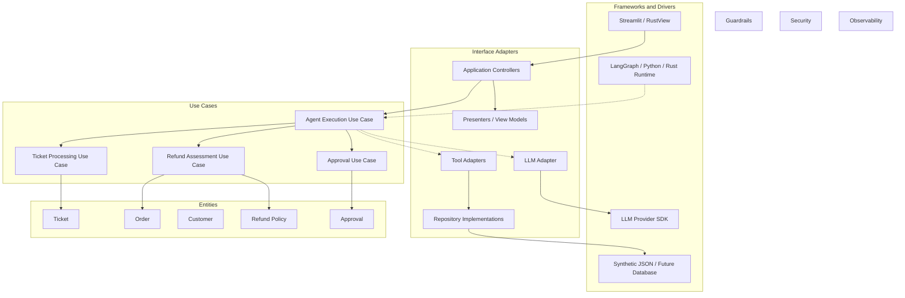
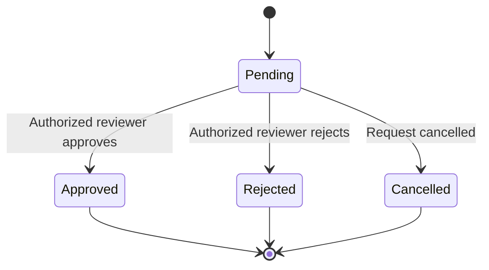
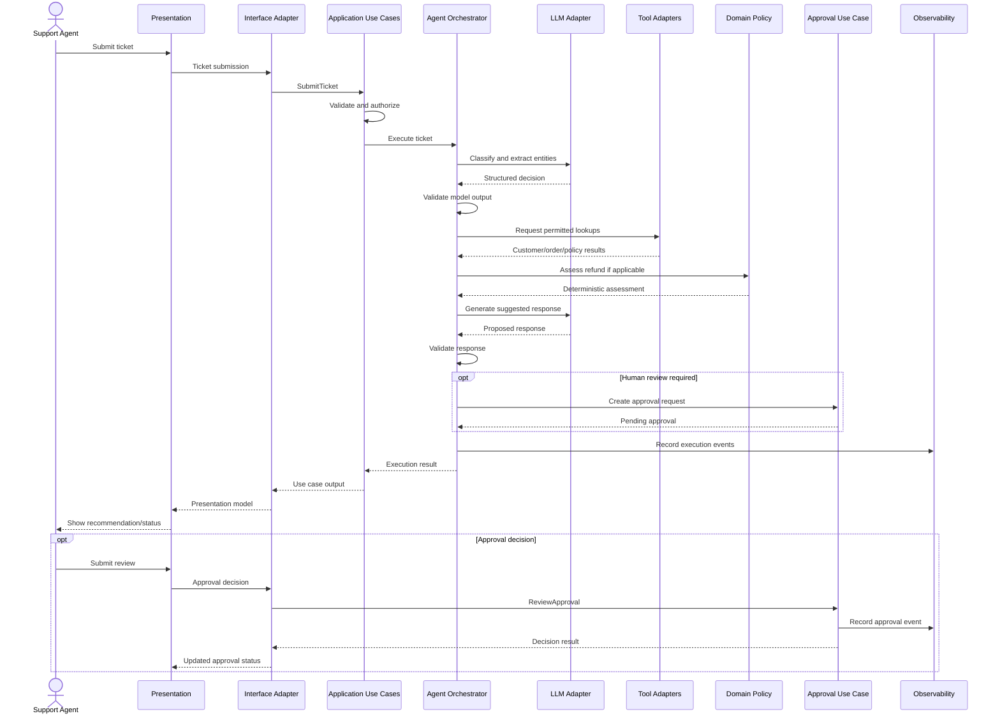

# System Architecture

**Project:** AI Customer Support & Ticket Resolution Agent  
**Status:** Initial architecture baseline  
**Architecture style:** Modular Monolith + Clean Architecture  
**Applies to:** `ai-agent-py`, `ai-agent-lc`, `ai-agent-rs`

---

## 1. Purpose

This document defines the shared high-level architecture for the AI Customer Support & Ticket Resolution Agent.

The architecture supports three independent implementations:

| Repository | Implementation |
|---|---|
| `ai-agent-py` | Plain Python and Streamlit |
| `ai-agent-lc` | LangChain, LangGraph, and Streamlit |
| `ai-agent-rs` | Rust and RustView |

All implementations must preserve the same business rules, domain behavior, agent contracts, security boundaries, and evaluation expectations.

The architecture is technology-neutral at the business level. Individual implementation details belong in the corresponding implementation repositories.

## 2. Architecture goals

The architecture must:

1. Accept and classify customer support tickets.
2. Identify customer intent and relevant entities.
3. Retrieve customer, order, and policy information.
4. Assess refund eligibility using deterministic business rules.
5. Generate a suggested customer response.
6. Route sensitive recommendations through human approval.
7. Escalate tickets when required.
8. Record execution history and audit events.
9. Support evaluation, testing, security, and observability.
10. Allow three implementations to be compared using common requirements.

## 3. Architecture style

### 3.1 Modular monolith

The initial solution will use a modular monolith.

A modular monolith is one deployable application organized into well-defined internal modules.

Benefits:

- Clear module boundaries.
- Simpler local development.
- Lower deployment complexity.
- Easier debugging.
- Strong separation of business responsibilities.
- A future migration path to independently deployed services if justified.

The initial architecture does not require independently deployed microservices.

### 3.2 Clean Architecture

The solution will follow Clean Architecture.

Clean Architecture organizes software into concentric responsibility boundaries. Business rules are protected from changes in external technologies.

The four conceptual layers are:

1. **Entities:** Enterprise business rules and domain models.
2. **Use Cases:** Application-specific business workflows.
3. **Interface Adapters:** Translate between external representations and internal application models.
4. **Frameworks and Drivers:** External technologies, tools, databases, UI frameworks, and infrastructure.

### 3.3 Dependency Rule

The most important Clean Architecture principle is:

**Source-code dependencies must point inward.**

- Entities must not depend on use cases or infrastructure.
- Use cases may depend on entities and abstractions they define.
- Interface adapters implement or translate those abstractions.
- Frameworks and drivers provide concrete external technology integrations.

For example:

- The refund policy must not import LangChain.
- The ticket use case must not depend on Streamlit.
- The domain must not depend on a specific LLM SDK.
- An LLM adapter may implement an application-defined interface.
- A repository adapter may implement an interface defined by an inner layer.

Runtime calls can cross these boundaries through interfaces. The direction of source-code dependencies must still point inward.

### 3.4 Architecture boundaries

The four layers are supported by cross-cutting capabilities:

- Guardrails.
- Security.
- Observability.

These capabilities must respect the dependency rule and must not introduce infrastructure dependencies into the domain.

## 4. High-level architecture diagram

The diagram illustrates logical layers and runtime interactions. Concrete implementations must preserve inward source-code dependencies.

## 5. Clean Architecture layers

### 5.1 Entities — Domain Enterprise Rules

**Responsibility:** Represent core business concepts and enforce enterprise business invariants.

Components:

| Component | Responsibility |
|---|---|
| Ticket | Ticket identity and lifecycle |
| Customer | Customer identity and domain representation |
| Order | Order information and status |
| RefundAssessment | Deterministic refund outcome |
| BusinessPolicy | Business policy representation |
| Approval | Human approval state |
| Domain Services | Business rules spanning domain entities |
| Value Objects | Money, ConfidenceScore, ReasonCode |

Rules:

- No dependency on UI frameworks.
- No dependency on agent frameworks.
- No dependency on LLM providers.
- No database or network dependencies.
- No application-specific orchestration.

The domain layer must remain independently testable.

### 5.2 Use Cases — Application Business Workflows

**Responsibility:** Coordinate application-specific workflows using domain entities and application-defined abstractions.

Initial use cases:

| Use case | Responsibility |
|---|---|
| SubmitTicket | Accept and validate a ticket submission |
| ProcessTicket | Coordinate ticket processing |
| ClassifyTicket | Request and validate ticket classification |
| RetrieveOrder | Retrieve order information |
| RetrieveCustomer | Retrieve customer information |
| RetrievePolicy | Retrieve business policy |
| AssessRefund | Invoke deterministic refund assessment |
| GenerateResponse | Prepare a suggested customer response |
| RequestApproval | Create an approval request |
| ReviewApproval | Process an authorized human decision |
| EscalateTicket | Route a ticket for human handling |
| GetExecutionHistory | Retrieve execution history |

Use cases define the application flow.

They may depend on abstractions such as:

- `OrderRepository`
- `CustomerRepository`
- `PolicyRepository`
- `TicketRepository`
- `LLMClient`
- `ToolExecutor`
- `ExecutionRepository`
- `ApprovalRepository`
- `AuditLogger`

These abstractions must be owned by an appropriate inner layer. Infrastructure implements them.

The use case layer must not depend directly on a concrete LLM SDK, Streamlit, RustView, or database driver.

### 5.3 Interface Adapters

**Responsibility:** Convert data between external systems and the internal application model.

Components:

| Component | Responsibility |
|---|---|
| Controllers | Accept external requests and invoke use cases |
| Presenters | Convert use case output into UI-ready models |
| Repository Implementations | Implement application-defined repository interfaces |
| LLM Adapter | Translate internal model requests into provider requests |
| Tool Adapters | Translate tool requests into validated application operations |
| Input Mappers | Convert external input into internal request models |
| Output Mappers | Convert internal results into external response models |

Examples:

- A Streamlit controller converts a form submission into a `SubmitTicket` request.
- A repository adapter reads a synthetic JSON fixture and maps it to a domain entity.
- An LLM adapter converts an internal classification request into the selected provider's API format.
- A presenter converts an execution result into a UI-ready view model.

### 5.4 Frameworks and Drivers

**Responsibility:** Provide external technology integrations.

Examples:

| Technology | Purpose |
|---|---|
| Streamlit | Python user interface |
| RustView | Rust user interface |
| LangChain | LLM integration and framework utilities |
| LangGraph | Workflow orchestration |
| LLM provider SDK | Model communication |
| JSON files | Initial synthetic data |
| Future database | Persistent storage |
| Python runtime | Python execution |
| Rust runtime | Rust execution |

Frameworks and drivers are replaceable details. They must not define core business behavior.

## 6. Cross-cutting capabilities

### 6.1 Guardrails

Guardrails protect input, model output, tools, policy decisions, and customer-facing responses.

| Boundary | Control |
|---|---|
| Ticket input | Schema validation and length limits |
| Model input | Prompt construction and untrusted-content separation |
| Model output | Structured-output validation |
| Tool invocation | Tool allowlist, schema validation, authorization |
| Refund decision | Deterministic policy evaluation |
| Approval | Reviewer authentication and authorization |
| Suggested response | Output validation and unsupported-claim checks |

Guardrails must be enforced by application components. A prompt instruction alone is not a security control.

### 6.2 Security

Security requirements:

- Role-based access control.
- Roles: `SUPPORT_AGENT`, `SUPERVISOR`, `ADMIN`.
- Authentication context established outside the LLM.
- Authorization checks at protected application operations.
- Least-privilege tool access.
- No credentials in prompts or tool arguments.
- Synthetic data only.
- Safe error messages.
- Audit records for important decisions and approvals.
- No unrestricted autonomous actions.

The initial implementation may use a simplified local identity mechanism. Production authentication and identity-provider integration remain future decisions.

### 6.3 Observability

Every execution must be traceable.

Record:

- Request and correlation IDs.
- Execution ID.
- Ticket ID.
- Agent and prompt version.
- Model/provider metadata when available.
- Tool names and invocation outcomes.
- Guardrail decisions.
- Policy assessment and policy version.
- Approval events.
- Execution status.
- Duration and error classification.
- Token usage when available.

Do not log secrets, credentials, or unnecessary customer data.

Start with structured logs and execution history. Distributed tracing and OpenTelemetry integration can be introduced later.

## 7. Agent orchestration architecture

The Agent Orchestrator coordinates the agent's work through application use cases.

Responsibilities:

1. Receive an execution request.
2. Establish an execution ID and correlation context.
3. Validate the incoming ticket.
4. Apply input guardrails.
5. Request intent classification and entity extraction.
6. Validate the structured agent decision.
7. Select permitted application tools.
8. Retrieve required customer, order, and policy information.
9. Invoke deterministic domain policies.
10. Generate a suggested response.
11. Determine whether human approval or escalation is required.
12. Produce an execution result.
13. Record audit events and execution telemetry.

The orchestrator coordinates dedicated use cases and domain services. It must not contain every business rule itself.

### 7.1 Framework independence

| Repository | Orchestration mechanism |
|---|---|
| `ai-agent-py` | Custom Python application orchestrator |
| `ai-agent-lc` | LangChain integrations and LangGraph workflow |
| `ai-agent-rs` | Rust application workflow/orchestrator |

Framework-specific abstractions must remain behind implementation boundaries.

All implementations must satisfy the shared execution contract and business behavior.

## 8. Tool architecture

The agent does not access data stores directly.

It requests application-controlled tools.

Initial tools:

| Tool | Purpose | Access |
|---|---|---|
| `customer_lookup` | Retrieve customer information | Read-only |
| `order_lookup` | Retrieve order information | Read-only |
| `policy_lookup` | Retrieve applicable policy information | Read-only |

Tool execution lifecycle:

1. Agent proposes a tool call.
2. Application resolves the registered tool.
3. Application validates arguments.
4. Application checks authorization.
5. Tool adapter executes the request.
6. Tool adapter returns a structured result or error.
7. Application records the outcome.
8. Orchestrator determines the next workflow step.

Unknown tools, invalid arguments, and unauthorized requests must be rejected.

The initial portfolio scope contains no real financial transaction tool.

## 9. Refund decision architecture

Refund eligibility is a deterministic domain decision.

Processing sequence:

1. Retrieve the order.
2. Retrieve the applicable refund policy.
3. Validate required order and customer information.
4. Evaluate the return window.
5. Evaluate the refund amount against the configured cap.
6. Check damaged-item evidence requirements.
7. Produce a structured `RefundAssessment`.
8. Determine whether human review is required.

Initial policy rules:

| Rule | Initial value |
|---|---|
| Return window | 30 calendar days |
| Refund cap | CAD 100 per transaction |
| Damaged goods | Image verification required |
| Financial execution | Out of scope |

The LLM may summarize the result but cannot change eligibility or policy reason codes.

An eligible assessment does not constitute authorization to issue a refund.

## 10. Human approval architecture

Human approval is an application-controlled workflow.

The application must:

- Create an approval request tied to a specific execution and recommendation.
- Authenticate the reviewer.
- Authorize the reviewer's role.
- Validate that the request is still pending.
- Prevent duplicate or conflicting decisions.
- Record the decision and reviewer identity.
- Emit an audit event.

The initial portfolio implementation records approval decisions but does not execute real refunds.

## 11. Data architecture

The initial data source is synthetic JSON.

Logical repositories:

- CustomerRepository.
- OrderRepository.
- PolicyRepository.
- TicketRepository.
- ExecutionRepository.
- ApprovalRepository.

The first three repositories read synthetic fixtures. The remaining repositories may use an appropriate local persistence adapter during implementation.

Repository interfaces belong to an inner application boundary; concrete repository implementations belong in Interface Adapters or infrastructure.

A future database can replace the JSON adapters without changing the business contracts.

A production database is not part of the initial architecture.

## 12. Execution sequence

## 13. Deployment architecture

Initial deployment is intentionally simple:

- One application deployment per implementation.
- One UI entry point.
- Internal Clean Architecture layers.
- Synthetic JSON fixtures.
- Configurable LLM provider integration.
- Local development configuration.
- No mandatory external database.
- No mandatory microservice infrastructure.

The architecture must not require separate containers for every logical module.

Each implementation must provide reproducible setup and execution instructions.

## 14. Quality attributes

| Attribute | Architectural approach |
|---|---|
| Maintainability | Explicit layer boundaries and use cases |
| Testability | Domain and application logic isolated from external dependencies |
| Security | Application-controlled authorization and tool validation |
| Reliability | Structured errors, validation, and controlled retries |
| Observability | Correlation IDs, logs, metrics, and audit events |
| Portability | Provider and repository abstractions |
| Consistency | Shared domain model and cross-implementation contracts |
| Extensibility | Replaceable adapters and framework integrations |
| Performance | Measure execution and tool latency before optimization |

## 15. Architecture constraints

1. Start as a modular monolith.
2. Follow Clean Architecture's Dependency Rule.
3. Keep entities independent of frameworks and infrastructure.
4. Keep use cases independent of concrete external technologies.
5. Keep UI logic independent of business policies.
6. Keep LLM provider integration behind an application-defined abstraction.
7. Treat model-generated tool calls as untrusted proposals.
8. Enforce authorization in the application.
9. Keep refund eligibility deterministic.
10. Require human approval for protected workflows.
11. Use synthetic data.
12. Do not execute real financial transactions.
13. Preserve shared contracts across all three implementations.

## 16. Architecture decisions

| Decision | Initial choice |
|---|---|
| Architecture style | Modular monolith |
| Internal architecture | Clean Architecture |
| Dependency direction | Inward |
| Domain model | Shared technology-neutral specification |
| Data source | Synthetic JSON fixtures |
| Persistence | Repository abstractions |
| LLM integration | Provider abstraction |
| Python orchestration | Custom application orchestrator |
| LangChain orchestration | LangGraph workflow |
| Rust orchestration | Rust application workflow |
| User interface | Streamlit / RustView |
| Refund evaluation | Deterministic domain service |
| Sensitive workflow | Human approval |
| Real financial execution | Out of scope |

Future decisions include:

- Production authentication and identity provider.
- Database selection.
- LLM provider and model selection.
- API deployment boundary.
- Production hosting.
- OpenTelemetry integration.
- Whether any module should eventually become an independently deployed service.

Changes to these decisions must be documented and justified.

## 17. Definition of Done

- [ ] Architecture style is documented as Modular Monolith + Clean Architecture.
- [ ] Four Clean Architecture layers are defined.
- [ ] Dependency Rule is explicit.
- [ ] Cross-cutting capabilities are defined.
- [ ] Component responsibilities are documented.
- [ ] Agent orchestration responsibilities are documented.
- [ ] Tool execution boundaries are documented.
- [ ] Deterministic refund decision flow is documented.
- [ ] Human approval workflow is documented.
- [ ] Security and guardrail boundaries are explicit.
- [ ] Data and repository architecture are documented.
- [ ] Execution sequence diagram is included.
- [ ] Deployment assumptions are documented.
- [ ] Architecture is consistent with Steps 1–6.
- [ ] The specification is committed to `ai-agent-shared`.

---

**Next step:** Define the Definition of Done for the complete portfolio project.
